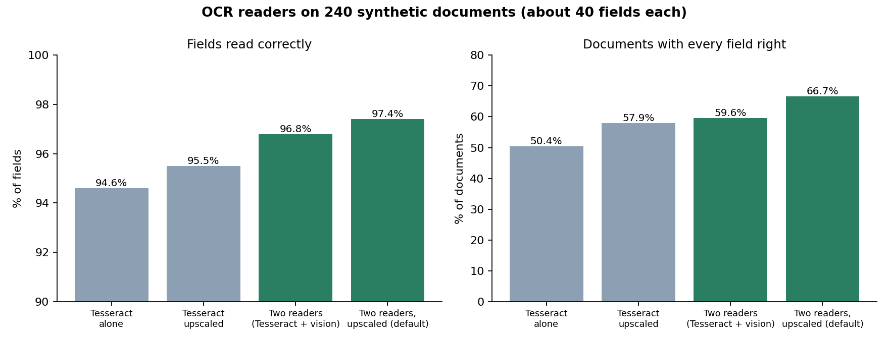
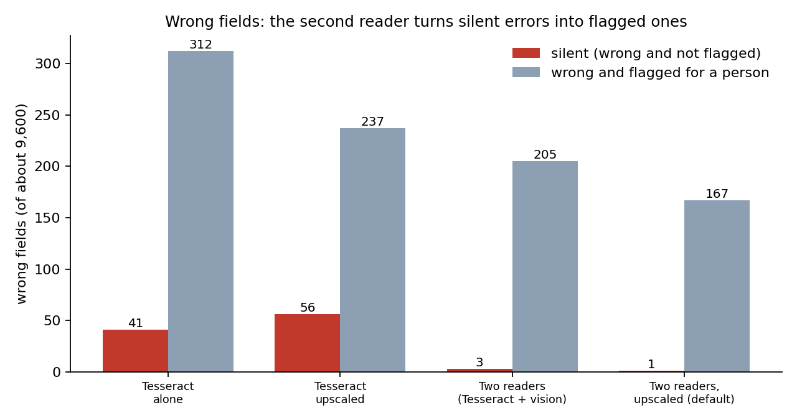
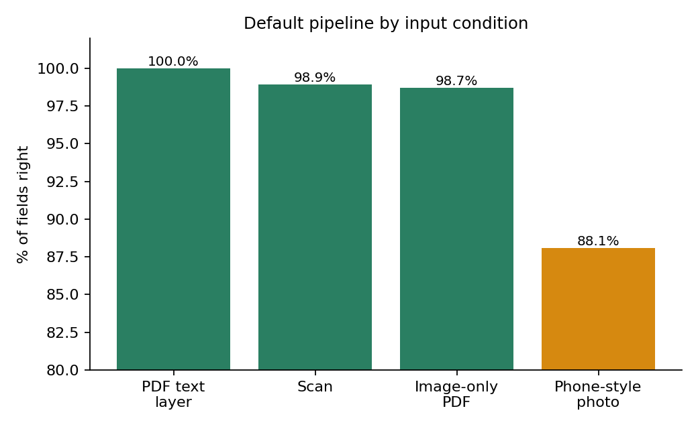
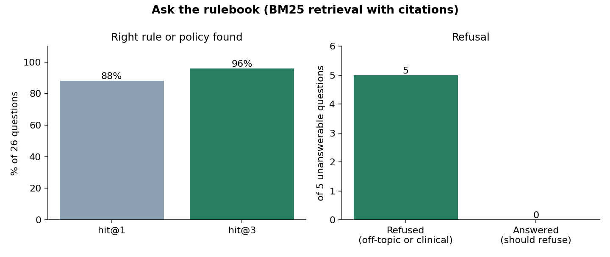

# 45 | Importing claims from files, the signed ledger, and live updates

Three features added after the Rust port: claims that arrive as a PDF, a photograph, FHIR or CSV; a cryptographic ledger over the audit logs; and a live-update stream for the console. Each section says what it does, how it was tested, and what it does not do.

## 1. Importing claims from files

**Why.** Claims do not always arrive as JSONL. The system's job is to convert whatever arrives into the one claim envelope, never to decide on the converted claim by itself.

**Path.** (1) *Gate* in the server (`cg-ingest/gate.rs`): 16 MB cap, the type read from the bytes (PDF, PNG, JPEG only), picture size from the header (40-megapixel cap, a decompression-bomb guard), a plain-byte scan of PDFs for active-content names, a **polyglot check** (an upload that starts as one format and contains another is refused: an executable, archive, jar or Office container before a PDF header, an embedded `This program cannot be run in DOS mode`, a Java archive inside a PDF, another file attached after a picture's `IEND` / `FFD9` end marker; a picture with no end marker is refused as cut off). The server never parses a PDF or decodes a picture. (2) *Reader* (`deploy/ocr/service.py`, its own container on a network with no route out, read-only, memory- and process-limited): resolves the PDF's structure and refuses JavaScript, launch actions, open actions, embedded files, XFA, rich media and encryption; takes the text layer with PDFium when the page has one; otherwise renders the page and reads it with Tesseract (word confidence) and, when configured, a vision model as a **second independent reader**. (3) *Extraction* (`cg-ingest/extract.rs`): labelled fields, table rows recognised by what a row looks like, dates and numbers read only when unambiguous (an ambiguous `10/09/2026` is kept as written and the draft cannot be accepted until a person decides), a catalogue check on every identifier, arithmetic checks, per-field evidence and confidence, and a cross-check of the two readers. The result is a **draft**, not a claim. (4) The console page *Import from files* shows the page beside editable fields; empty or doubtful fields are marked with the reason; the draft is checked by the server's transport contract; a person ticks that they compared every field with the page; only then does it go through the ordinary submit. JSON, JSONL, FHIR and the five CSV tables use the same page as a record-by-record preview.

**Which vision model.** `baidu/Unlimited-OCR` (3.3B parameters, 0.5B active, MIT licence; OmniDocBench v1.5 overall 93.2). It reads fields almost perfectly (3 to 6 s a page on the development laptop) but, through Ollama, returns table cells fused together and can fall into a repetition loop on its plain-text prompt, so it is used with the layout prompt, a loop guard, and Tesseract supplying the table rows; the fused text verifies them. Serve it through llama.cpp or Ollama from the GGUF, or vLLM; do not use `trust_remote_code` from the live hub on the server. The Ollama build tested is a third-party conversion: convert the official weights yourself and record hashes before production.

**Evidence** (`rust/tools/doc_eval.py` on documents from `make_docs.py`: 240 documents, two layouts, four conditions, answer key known; about 40 fields each):

| Reader | Fields right | Documents fully right | Wrong fields | Flagged | Silent errors |
|---|---|---|---|---|---|
| PDF text layer (digital) | 100% | 100% (60/60) | 0 | - | 0 |
| Tesseract alone | 94.6% | 50.4% | 353 | 312 | 41 |
| Tesseract alone, small pages upscaled | 95.5% | 57.9% | 293 | 237 | 56 |
| two readers, cross-checked | 96.8% | 59.6% | 208 | 205 | 3 |
| two readers, upscaled (the default) | 97.4% | 66.7% | 168 | 167 | 1 |

A *silent* error is a wrong field nothing flagged (not empty, no warning, readers agree, confidence not low). Per condition for the default: scan 98.9%, image-only PDF 98.7%, phone-style photo 88.1% (12% of photos perfect). The evaluation found two bugs that were fixed: a claim line with an empty date cell was dropped, and a two-number row must be flagged, not guessed. Other tests: 41 extractor/gate/reader unit tests, 9 API flow tests with a stub reader on a real socket, 18 black-box checks on the reader (hostile PDFs, bad types, oversize), and an end-to-end run in real Chrome (`rust/tools/import_ui_test.py`).

**Borrowed from the Attijari mail-attachment pipeline** (same author's earlier project; reviewed, only ideas and strings taken, no code run): (1) the polyglot and embedded-executable signatures above (`polyglot_file`, `suspicious_exe_in_document`; its CI lesson that "MZ" is only a signal at the start of a region, because "DMZ" is ordinary text, is kept and tested); (2) invisible-character handling: bidi overrides, zero-width characters, the BOM and the Unicode Tags block are removed from every page's text before extraction and the draft carries a warning that they were found, because they are how a message is hidden from a person but read by a reader or a model; (3) the fail-closed rule that "could not look" must never be represented as "found nothing" (already how the import path behaves: an unavailable reader or a failed gate is an error, never an empty draft). Its sandbox settings (no network, read-only filesystem, all capabilities dropped, memory and process limits) were already matched by the reader container. Not taken: its YARA, oletools and archive scanners (the gate allows only PDF, PNG and JPEG, so Office, archive and script formats never reach a scanner) and its antivirus-style reputation lookups (claim data must not leave the site). Tests: one gate test with six two-format files plus harmless look-alikes and one extractor test; 120 real generated pictures and PDFs pass the gate unchanged.

**Not done or not known.** Real hospital paper, handwriting, stamps and Arabic are untested (the container carries the Arabic Tesseract model; the vision model's Arabic is unmeasured). Hidden text in a PDF's text layer is read like visible text, which is why a person compares the page. Photos are poor enough that nothing may be queued unseen. The colleague's repository (an LLM agent on a cloud model) was reviewed and not adopted; reasons are in the project notes.

**Reader image, built and checked.** `deploy/ocr/Dockerfile` builds (401 MB; the first build exposed a pip flag that does not exist, now removed, and the package upgrade added so published Debian fixes are included). The 18 black-box reader checks pass **inside the container run with the production restrictions** (read-only, tmpfs `/tmp`, all capabilities dropped, no-new-privileges, 2 GB, 128 processes, 2 CPUs): `python rust/tools/ocr_service_test.py --container claimguard-reader:latest`. Trivy (HIGH and CRITICAL, fixed only) on the saved image: first build 4 HIGH in Debian packages (pcre2, openssl, all with fixes), after `apt-get upgrade` 0; the Python packages (pillow, pypdf, pypdfium2, pip) 0. The Linux Tesseract build reads a zero in an id as the letter O where the Windows build did not (`PAT-O002`): that is the misread the extractor's catalogue check and confidence flags exist for, and the reader test tolerates it. Not yet done: running the container beside the real compose stack on the target server.

**Deploy.** `bash deploy/rust/install.sh <site> internal ai docs` adds the reader container; Caddy allows 17 MB only on the two import paths.

## 2. The signed ledger

The audit logs were hash chains with an HMAC anchor (checkable only with the secret, and blind to rows cut off the end). A **checkpoint** closes both gaps: the worker, the only holder of an Ed25519 seed, signs the log name, row count, head hash, an RFC 6962 Merkle root and the time, every few minutes. The API holds only the public key. Anyone with the public key can check that the log still holds the history each checkpoint vouches for (a rewritten row, even with the whole chain recomputed, changes the Merkle root; a cut log has fewer rows than a checkpoint said; a forged checkpoint fails its signature; checkpoints going backwards are refused), and can check a single event's **inclusion proof** with nothing but that proof and the key, without seeing any other event. `cg ledger keygen|pubkey|checkpoint|verify|prove|verify-proof`; `GET /api/v1/ledger` and `/ledger/proof`; a health probe; a card with a Proof button on the audit page. Tests: 8 unit tests (every leaf of every tree from 1 to 40 leaves; cut, rewritten-with-repaired-chain, forged, altered and reordered checkpoints) and 14 end-to-end checks (`rust/tools/ledger_test.py`). **Limits:** rows removed after the newest surviving checkpoint are covered by the anchor and the mirror, not the ledger; reading a whole log needs the data key because logs are encrypted on disk (a proof needs no secret); someone holding both the seed and the log files could re-sign.

## 3. Live updates

`GET /api/v1/work/events?topics=inbox|queue` is a server-sent-event stream carrying only `hello`, `changed` and `end`, never claim data. Per connection the server asks the ordinary authenticated route `/work/changes` (the caller's own cookie) for a fingerprint of what the open page shows every 3 seconds and says `changed` when it differs; the page then re-reads through the normal routes, so permissions and masking stay in one place. A revoked session ends the stream. Limits: 16 streams per address, 256 in total; the proxy neither compresses nor buffers it. Tested with 21 black-box checks, in Chrome (a change noticed in 1.7 s against the 20 s poll) and through the real Caddy image (`rust/tools/sse_test.py`, `sse_proxy_test.py`).

**WebSocket.** `GET /api/v1/work/ws?topics=inbox|queue|notifications` is the same watcher on a second transport (RFC 6455 handshake, text frames `{"event":"hello"}`, `{"event":"changed"}`, `{"event":"end"}`, a ping every 15 s of quiet; never claim data). The first check is the ordinary authenticated request, so a missing session, permission or a bad topic is a normal 401/403/422 and no upgrade happens. Because a WebSocket is not covered by the browser's same-origin policy, a request whose `Origin` is not this site (scheme http/https and the same host and port as the `Host` header) is refused with 403, so a page on another site cannot open a socket with the visitor's cookie; a client that sends no `Origin` is not a page and carries no victim's cookie. The limits are shared with the event stream (16 per address, 256 in total, five minutes); client frames must be masked and are read only for ping, pong and close (an unmasked frame is closed with 1002, a message over 1 KiB with 1009). The console opens the socket first and falls back to the event stream when it cannot be opened (a proxy that does not pass upgrades, or a browser that blocks it); the timers stay as the last fallback. Tested by 33 black-box checks (`rust/tools/ws_test.py`) and unit tests for the accept key, the origin rule and the frame reader (`server.rs`).

## 4. Payer rules as editable, versioned, approved data

The fifteen rules are code (the YARA pack, hashed with the build) and are not editable. What a payer contract says (`rules/policies.json`: per policy the currency, the days allowed to submit, the allowed providers, the services that need authorization, the document each service requires, the highest unit price and quantity per service) is data, and the console page **Payer rules** (`#/rules`, `GET/POST /api/v1/rules/payer`, `POST /rules/payer/validate`) lets an administrator change it. A change is checked (shape, ranges, every service code must exist in the catalogue, no empty provider list, a three-letter currency), shown as a list of differences, needs a reason of 10 to 300 characters, and with two or more administrators does **not** take effect when asked for: it becomes a request that a different administrator approves with a fresh authenticator code (the same dual control as the other dangerous actions; the requester cannot approve their own). Each applied change is a numbered **version** appended to a hash-chained log (`payer_rules.jsonl`: who asked, who approved, why, the differences and the whole new table), so what the rules were at any time is as tamper-evident as the audit logs; a rollback is a new version carrying an old table. The engine switches to the new table without a restart (other processes notice within three seconds), and the rulebook hash written in every triage receipt covers the table, so a claim sent again after a change is judged again and its receipt says under which table. While the table is the shipped one the hash is exactly the pack's, as before. Tests: 3 engine tests (version, hot switch and hash change, rollback restores the original hash; ten kinds of unsafe table refused with nothing written; a second process sees the change, a restart keeps it) and 16 end-to-end checks (`rust/tools/payer_test.py`: reviewer refused, bad table explained and refused, change waits for approval, self-approval refused, approval applies it, history names both people, rollback through the same approval, history verifies). **Limits:** only the policies table is editable (not the service catalogue, the providers list or the rule logic); a change applies to claims judged afterwards (claims already triaged keep their receipts and are re-judged only when sent again or re-run); the approval payload carries the whole new table, so very large tables are limited by the approval record.

## 5. Ask the rulebook (retrieval with citations)

**What it is.** A question box over the text of the fifteen rules (title, what each checks, what to do about it) and the payer policy table **as it is in force now** (one passage per policy fact, each naming the table version). `GET /api/v1/knowledge/search?q=` (permission `claims.view`, question 1 to 300 characters) and the console page *Ask the rulebook*. Ranking is by meaning (sentence embeddings from a small sidecar, docs/52 section 7) when that service is configured and up, and BM25 (lexical; no model, no network, deterministic; `cg-engine/src/rag.rs`) otherwise; the reply says which (`mode`), and a semantic answer carries the caveat that the closest passage may not answer the question. The answer **is** the quoted passage with its source (`rule R008`, `policy EDU-BASIC (table version 3)`); nothing is generated, so nothing can be invented, and no clinical advice can be given. A question whose words barely touch the documents (fewer than two matching terms, or a weak score) is refused with "Not in the rulebook documents" instead of answered with the nearest guess. It never reads a claim, so it adds no privacy surface; the index is rebuilt when the payer table version changes, so an approved change is what people read about.

**Evidence.** 26 reviewer-style questions with the expected rule or policy (`rag.rs` tests; written from what a reviewer would ask, not tuned against the index): hit@1 88%, hit@3 96%; the one miss is "two identical lines on the same day" (the rule says *duplicate*, the question does not). 5 off-topic or clinical questions (weather, football, "recommend a treatment for diabetes", poem, empty) are all refused. Tests also check that a policy answer quotes the real limit and follows an edited table, that the corpus holds no claim data, and that results are deterministic. 8 end-to-end checks against a real server (`rust/tools/knowledge_test.py`: role, citation, refusal, bad input, markup as text, no session = 401); the page was reviewed in real Chrome at desktop and phone width.

**Limits, stated plainly.** It is retrieval, not a language model: it will not rephrase, combine or reason across passages. It is lexical, so a question using none of the documents' words misses (the one miss above). A dense retriever or a model that phrases the answer is possible later; it would have to beat these numbers on the same questions first. Attachment text from imported documents is deliberately **not** in the index (it is claim data; a person compares the page itself).
