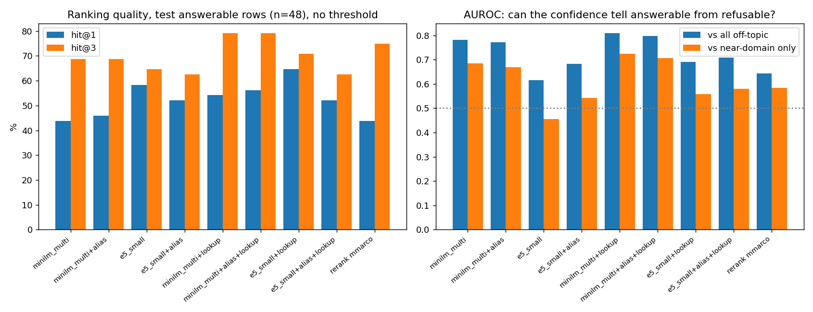
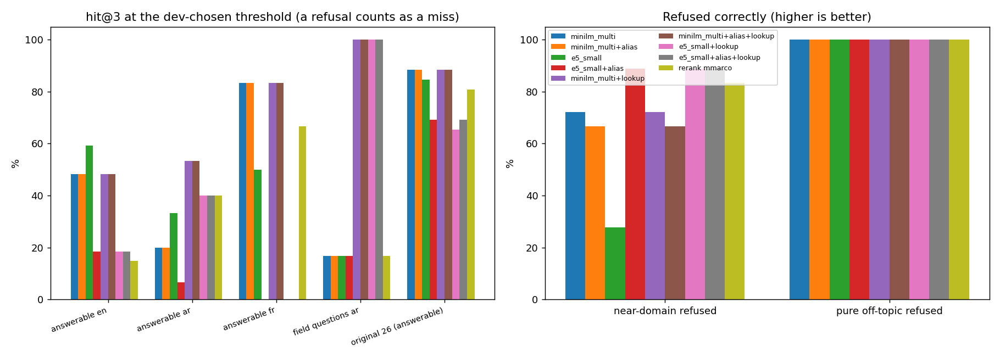
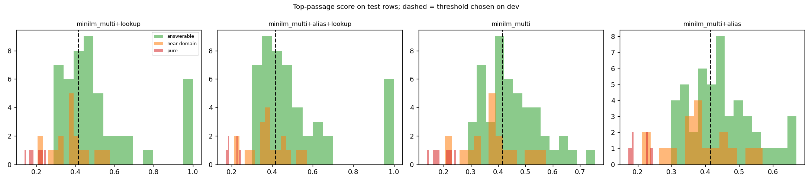
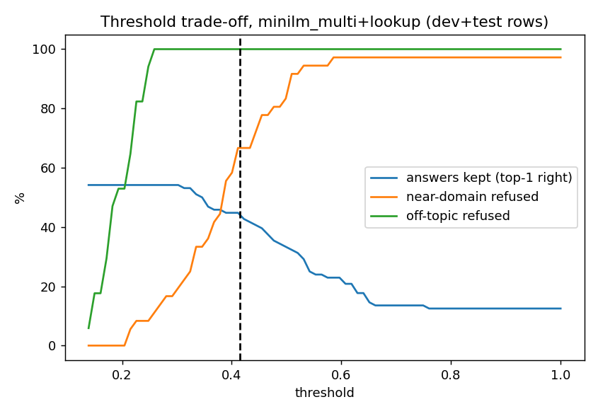

# 55 | Claims in Arabic, a field dictionary, and the second look at "Ask the rulebook"

Written 2026-10-18. Two jobs: (1) the system accepts a claim written in English **or** Arabic and knows what every field means; (2) rebuild the rulebook search after docs/52 admitted its regressions.

**Read this first.** All Arabic in this work (field names, enumerated values, month names, the Arabic test questions) was written by the assistant. **No native Arabic speaker has reviewed it.** A wrong entry can produce a refusal or a field mapped to the wrong English name; it cannot silently change a claim's amounts or identifiers (see the rules below). The question sets were also written by the assistant, not by adjusters. The bigger embedding models and rerankers named in the plan (multilingual-e5-base, bge-m3, bge-reranker-v2-m3) **were not evaluated**: see section 4 for what happened to the downloads. So "the best model" below means "the best of the two that could be run".

## 1. Arabic claims (`cg_core::localize`, `data/field_glossary.json`)

A claim is read into the one canonical claim (English keys and values, docs/03) before the transport contract and the rules see it.

- **Converted, and every change recorded** (path, kind, written, became; the original claim is kept with the claim as `localization`): Arabic field names to canonical keys, per scope (claim, coverage, line, authorization, attachment); Arabic enumerated values (coverage and authorization status, document status, attachment type, currency, service names such as "فحص مختبري" to `SVC-LAB`); Arabic-Indic and Persian digits; `٫` as decimal mark and `٬` as thousands mark; year-first dates in any digit system; Gregorian month names (Levant and Gulf variants).
- **Refused with the field and the reason, never guessed:** Hijri dates and years; day-first or ambiguous orders (`03/04/2026`); unknown Arabic field names or values; two entries for one field; the Arabic comma `،` in a number; any Arabic letter, non-ASCII digit or invisible/bidirectional character **inside an identifier** (identifiers are matched exactly by the rules, so `PAT-٠٠٧` is never turned into `PAT-007`).
- **Untouched:** free text (`notes`, attachment `text`) may be Arabic and is neither changed nor read for meaning.
- **English input is byte-identical.** A claim without Arabic or invisible characters returns the same value with no changes (tested).
- Hooked in at: single and batch intake (`cg-queue/flow.rs`), file ingest (`cg-ingest`), the import-validate route (returns the converted claim and the changes), and CSV headers in Arabic.

Tests: 16 unit tests in `localize.rs`; `cg-queue/tests/arabic_twin.rs` rewrites every valid public claim (development + validation) in Arabic (first Arabic label of each field, first Arabic word of each value, Arabic-Indic digits) and requires the same canonical claim and the same fifteen results. It passes. Limits of that test: it uses one Arabic spelling per field; it was generated from the same glossary it tests, so it proves the converter is consistent with the table, not that the table is right Arabic.

Not done: the OCR reader's Arabic language data was not checked; the console does not yet set `dir="auto"` on free text; Hijri conversion is deliberately not offered.

## 2. The field dictionary in "Ask the rulebook"

45 new passages (kind `field`), one per claim field, from the glossary: meaning (English, from docs/03), type, and which rules read it. Answers stay quoted passages with a citation.

- **Keyword mode** reads a field passage only when the question asks what a field is or means (otherwise the many shared words let the dictionary push the answering rule out of first place; with the dictionary ungated BM25 hit@1 fell from 88% to 65%, gated it is back to the original 88% / 92% hit@3).
- **Arabic dictionary lookup** (`fields_named`): a question that names a field by one of its whole Arabic labels *and* asks what it is ("ما هو رقم الفاتورة") returns that field first, before and regardless of the embedding. Measured, because the embedding is weak here.

## 3. The model comparison (`experiments/rag_v2/`, results in `results.json`)

Corpus 156 passages. Questions: 180 (the 54 + 17 of docs/52, the original 26 + 5, and 82 new frozen ones: field questions in English and Arabic, rule questions in Arabic and French, 26 near-domain refusals, 8 Arabic/French pure off-topic). Thresholds are chosen on dev rows only (objective: half hit@3, half mean refusal of near-domain and off-topic); the tables are test rows. Intervals are 95% Wilson; with n of 6 to 48 they are wide.

| test rows | minilm (current) | + lookup | e5-small | mmarco reranker gate |
|---|---|---|---|---|
| ranking hit@3, threshold-free (n=48) | 69% | **79%** | 65% | 75% |
| AUROC answerable vs off-topic | 0.78 | **0.81** | 0.62 | 0.64 |
| near-domain refused (n=18) | 72% | 72% | 28% (at its dev threshold) | 83% |
| Arabic field questions hit@3 (n=6) | 17% | **100%** | 17% | 17% |
| original 26: hit@3 at dev threshold | 88% | 88% | 85% | 81% |

Reading it: the multilingual MiniLM that is already shipped is the best of the two models that could be run, mainly on refusal; e5-small ranks the first hit slightly better but cannot tell a rulebook question from a near-domain one. The cross-encoder gate refused more near-domain questions but ranked and answered fewer real ones. **Arabic rule questions remain weak** (hit@3 about 20% before lookup; the lookup helps only field questions). Putting the Arabic field names into the embedded text gave no gain, so it is switched off (`EMBED_ALIASES`).

**Change shipped:** the refusal threshold moves from 0.29 to **0.415** (dev-optimal here; the 0.29 of docs/52 is what produced the 25% near-domain refusal the notes complained about); on the original 26 questions hit@3 stays at 88% at the new threshold. The dev half is only about 40 rows, so the threshold is a good estimate, not a precise one; the setting `EMBEDDER_THRESHOLD` remains.

### Graphs (`experiments/rag_v2/plot.py`, from `results.json` and `per_row.json`)

## 4. What is not settled

- **The larger candidates were not run, and the reason is the network, not the code.** The models were to be stored on the flash disk (`D:\hf_cache`, 85 GB free; set `HF_HOME=D:/hf_cache`). The three small ones (MiniLM, e5-small, the mmarco reranker) were copied there and are the ones measured. The large ones (e5-base 1.1 GB, bge-reranker-v2-m3 2.2 GB, bge-m3 2.3 GB) could not be fetched on 2026-10-18: measured speed from the Hugging Face CDN was 50 to 250 KB/s with read timeouts (2 to 14 hours for the three), and the bge-m3 file had received 0 bytes after seven minutes. Run them later with `HF_HOME=D:/hf_cache python experiments/rag_v2/run.py --models minilm_multi,e5_small,e5_base,bge_m3 --rerankers mmarco,bge_reranker && python experiments/rag_v2/plot.py`; the harness, prefixes (e5 `query:`/`passage:`) and graphs are ready and unchanged.
- `rust/tools/rag_parity.py` (product against experiment) was **not** re-run and still describes the old 111-passage, 0.29 setup; it needs updating before it is used as a gate again.
- The sidecar was not rebuilt and no browser check of an Arabic claim or question was done.
- Arabic rule questions, and any Arabic wording outside the glossary, are not reliably understood.
