# ClaimGuard AI: Test Evaluation Report

**Submission document: detection metrics, F1 score, false-positive rate, latency and limitations, with every experiment and every graph produced during the project.**

Team project for the CSTAM-VELODOC challenge (mentor: Dr. Wael Hilali). Report date: 2026-10-19. Branch `rust-rewrite`.
All claims, codes, prices and payer rules are **synthetic**. Nothing here has been measured on real hospital data, real payers or real reviewers.

## How to read this report

- **Section 1** answers the five things the submission asks for (detection metrics, F1, false-positive rate, latency, limitations) on one page.
- **Sections 2 to 6** are the detection evaluation itself: how it was measured, on what, and the tables.
- **Sections 7 to 16** are every other experiment we ran, in the order they were done, each with its graphs, its result and its limits. They answer the question "why is the system built this way?".
- **Section 17** collects all the limitations in one place. **Section 18** says how to re-run everything and where each file is.
- Every number is copied from a document or a result file in the repository (named next to it). Where a number comes from a simulation, a single laptop, or a test set written by the same team that built the feature, the text says so next to the number.

---

## 1. The answer on one page

| Question | Answer | Where |
|---|---|---|
| **Detection quality** | The rule engine reproduces the organizers' answer key exactly on all three public splits: 400 claims (development), 150 (validation), 50 (stress). Every FAIL is found and nothing is invented. | section 3 |
| **F1 score** | FAIL-detection precision, recall and F1 are **1.0000** on each split. Macro F1 over the five rule categories is **1.0000** (also over severities and over all 15 rules). Status accuracy 1.0000, 0 disagreements with the key in 9,000 results. | section 3 |
| **False-positive rate** | **0 valid claims wrongly flagged**: 0 of 160, 0 of 62 and 0 of 24 claims the key says have no FAIL. Exact 95% upper bounds on the true rate: **1.9%, 4.7%, 11.7%**. On 25,068 generated valid claims (against an independent oracle): 0, upper bound 0.01%. Zero observed is not zero true. | section 4 |
| **Latency** | The rule engine takes **0.19 ms per claim** (Rust). The Python reference measured a median 0.66 ms (p95 1.11 ms). The step that dominates end to end is the optional language-model explanation: a median **2.8 s**, with a 90 s ceiling and a template fallback. Reading a document: about 5 s per page. A 1,000-claim batch is taken in about 17.5 s. | section 6 |
| **Limitations** | The data is synthetic and small; a perfect score on public data cannot rank this system against a better one; the second implementation (the oracle) shares our reading of the rulebook; FHIR loses authorization records so rule R009 abstains on that path; latency is from one laptop, not the target server; the Arabic wording and the question sets were written by us, not reviewed by native speakers or operators; the learning experiments use simulated reviewers. | section 17 |

Three facts that matter for how to read the perfect scores:

1. The 15 rules are deterministic and were built against the public data. A correct implementation of the rulebook should reach 1.0 there. What the evidence shows is the **absence of errors found**, with upper bounds, not that the system beats an alternative.
2. The AI never decides. It writes an explanation of a finding the rules already made, and a reply that tries to change a verdict is rejected. The explanation step has its own measurements (sections 8 and 9).
3. When the system is not sure, it says so (`UNABLE_TO_ASSESS`) and routes the claim to a person. No failing claim became a pass in any test.

---

## 2. What was tested, and how

### 2.1 The system

A pre-validation copilot: it ingests claims (FHIR R4 JSON, CSV, JSONL, or a PDF, scan or photo through an isolated reader), checks them against a fictional payer rulebook of 15 rules with a deterministic engine, explains each finding with a tightly bounded AI step, and records every check, AI action and human decision in a tamper-evident, signed audit log. A person makes the final call. It exists twice: the original Python reference and a Rust rebuild that the desktop app and the server image run.


### 2.2 Three tiers of evidence, never merged into one headline number

- **Tier A, organizer answer key.** The only external truth: the organizers' synthetic dataset v1.0.0 (`data/development`, `data/validation`, `data/stress`, 600 claims, 9,000 results).
- **Tier B, our independent oracle.** `tests/oracle.py` is a second implementation of the 15 rules written from the rulebook text alone. It tests whether two implementations agree; a shared misreading would not show.
- **Tier C, hand-derived.** Expected statuses worked out by hand, one step either side of each boundary (123 cases).

### 2.3 Definitions

- **Positive class: `FAIL`**, as in the organizers' scorer. Precision, recall and F1 are computed on that class. `UNABLE_TO_ASSESS` (the engine's low-confidence state: an input is missing or unknown) is scored separately: an abstention is not an error, but an unnecessary one costs a reviewer time.
- **Rule categories** (our grouping; the rulebook defines none): completeness and arithmetic (R001, R007, R012); eligibility and coverage (R003, R004, R005, R015); timing (R002, R014); authorization and documentation (R008, R009, R010); catalogue, pricing and duplicates (R006, R011, R013). Counts are pooled within a category, then F1 is averaged across the categories where it is defined. Macro F1 is also reported by severity and over all 15 rules so the grouping cannot flatter the result.
- **Valid claims:** the claim-level false-positive rate is the share of claims with no gold FAIL where the engine raised any FAIL. Every rate carries the exact one-sided 95% (Clopper-Pearson) upper bound. By the rule of three, claiming an error rate below 1% needs about 300 error-free examples.
- **Confidence:** deterministic results carry `confidence: null` with kind `not_probabilistic`. Nothing pretends a rule result has a probability.

### 2.4 Provenance of every evaluation set

| Set | Tier | Name | Claims | Results | Label source | Limitation |
|---|---|---|---|---|---|---|
| S1 | A | data/development | 400 | 6,000 | organizers' `expected_results.jsonl` | rules were built against it |
| S2 | A | data/validation | 150 | 2,250 | organizers' key | same |
| S3 | A | data/stress | 50 | 750 | organizers' key | 9 of 15 rules have no failing example |
| S4 | A | handbook worked cases | 0 new | 0 | handbook | ten claims, already in S1 to S3 |
| S5 | A | the 600 public claims as FHIR bundles | 600 | 9,000 | key, same claim ids | FHIR carries no authorizations |
| S6 | A | the 600 public claims as CSV folders | 600 | 9,000 | key | lossless re-encoding |
| S7 | B | generated claims (seed 20260927) | 107,635 | 1,614,525 | independent oracle | oracle shares our reading |
| S8 | B | boundary-aware mutants (seed 20261004) | 33,945 | 509,175 | independent oracle | same caveat |
| S9 | C | boundary table | 123 | 140 | derived by hand | written by us, small |

Each set carries a file SHA-256 prefix, the script and seed that generated it, and its known limitation in `outputs/evaluation/provenance.json`.

---

## 3. Detection quality on the organizer data (tier A)

### 3.1 Python reference and Rust build, same scoring code

| Split | Claims | Precision | Recall | F1 (FAIL) | Macro F1 by category | Status accuracy | Disagreements with the key |
|---|---|---|---|---|---|---|---|
| 50-claim split (`data/stress`) | 50 | 1.0000 | 1.0000 | 1.0000 | 1.0000 | 1.0000 | 0 |
| `data/validation` | 150 | 1.0000 | 1.0000 | 1.0000 | 1.0000 | 1.0000 | 0 |
| `data/development` | 400 | 1.0000 | 1.0000 | 1.0000 | 1.0000 | 1.0000 | 0 |

The Rust engine (`rust/tools/phase2_eval.py`, `outputs/evaluation/rust_metrics.json`) and the Python reference (`outputs/evaluation/metrics.json`) give the same result. FAIL-detection errors over all results: 0 of 6,000, 0 of 2,250, 0 of 750 (95% upper bounds 0.05%, 0.13%, 0.40%). Missed abstentions and false abstentions: 0 on all three splits; `NOT_IMPLEMENTED`: 0.

### 3.2 By rule category (true positives, all F1 = 1.0)

| Category | 50-claim | validation | development |
|---|---|---|---|
| completeness and arithmetic | 11 | 37 | 82 |
| eligibility and coverage | 3 | 30 | 101 |
| timing | 0 (F1 undefined) | 11 | 31 |
| authorization and documentation | 6 | 14 | 41 |
| catalogue, pricing and duplicates | 6 | 25 | 64 |

### 3.3 By rule (F1, number of failing claims)

| Rule | development | validation | 50-claim |
|---|---|---|---|
| R001 | 1.0000 (36) | 1.0000 (17) | 1.0000 (8) |
| R002 | 1.0000 (11) | 1.0000 (4) | n/a (0) |
| R003 | 1.0000 (28) | 1.0000 (7) | 1.0000 (3) |
| R004 | 1.0000 (28) | 1.0000 (7) | n/a (0) |
| R005 | 1.0000 (26) | 1.0000 (6) | n/a (0) |
| R006 | 1.0000 (24) | 1.0000 (10) | n/a (0) |
| R007 | 1.0000 (23) | 1.0000 (7) | n/a (0) |
| R008 | 1.0000 (11) | 1.0000 (4) | n/a (0) |
| R009 | 1.0000 (15) | 1.0000 (5) | 1.0000 (3) |
| R010 | 1.0000 (15) | 1.0000 (5) | 1.0000 (3) |
| R011 | 1.0000 (10) | 1.0000 (4) | n/a (0) |
| R012 | 1.0000 (23) | 1.0000 (13) | 1.0000 (3) |
| R013 | 1.0000 (30) | 1.0000 (11) | 1.0000 (6) |
| R014 | 1.0000 (20) | 1.0000 (7) | n/a (0) |
| R015 | 1.0000 (19) | 1.0000 (10) | n/a (0) |

**Read each cell with its count.** In the 50-claim split, **9 of the 15 rules have no failing example at all**, so their F1 is undefined and left out of the average, and the rest have as few as 3. That split cannot test most rules for missed failures. The 400-claim development split has at least 10 failing examples for every rule, and validation at least 4, so conclusions about single rules rest on those two, with the 50-claim split as a check.

### 3.4 The FHIR path: the one real cost

Claims read back from FHIR bundles (S5) score F1 **0.9745** (precision 1.0000, recall 0.9502, status accuracy 0.9656, 310 disagreements). Every one of the 310 disagreements is rule R009 (authorization record matches service) becoming `UNABLE_TO_ASSESS`: a FHIR bundle in this dataset carries no authorization records, so the rule cannot be checked. 23 true FAILs and 287 PASSes become abstentions. The engine says so instead of guessing, the failing claims route to a reviewer, and **no failing result became a PASS**. The cost is reviewer workload: 134 of 201 fully clean claims (66.7%) receive an unnecessary abstention on this path. The CSV path (S6) is lossless: F1 1.0000, 0 disagreements. `rust/tools/compare_ingest.py` (35 checks) confirms the 600 public claims in all three formats give claims and reports identical to the Python reference.

### 3.5 Baselines: would a weak system also score well?

| Set | Predictor | Precision | Recall | F1 (FAIL) | Status accuracy |
|---|---|---|---|---|---|
| development | always PASS | n/a | 0.0000 | 0.0000 | 0.8357 |
| development | organizers' starter baseline (3 of 15 rules) | 1.0000 | 0.2759 | 0.4324 | 0.2000 |
| development | this system | 1.0000 | 1.0000 | 1.0000 | 1.0000 |
| validation | always PASS | n/a | 0.0000 | 0.0000 | 0.8351 |
| validation | starter baseline | 1.0000 | 0.2906 | 0.4503 | 0.2000 |
| validation | this system | 1.0000 | 1.0000 | 1.0000 | 1.0000 |
| stress | always PASS | n/a | 0.0000 | 0.0000 | 0.7987 |
| stress | starter baseline | 1.0000 | 0.4231 | 0.5946 | 0.2000 |
| stress | this system | 1.0000 | 1.0000 | 1.0000 | 1.0000 |

The metric does discriminate: predicting PASS for everything scores F1 0 and the starter baseline well below 1.

---

## 4. Valid claims are preserved (false positives)

| Set | Claims with no gold FAIL: engine raised a FAIL | 95% upper bound | Results on fully clean claims: false alarms |
|---|---|---|---|
| development | 0 / 160 | 1.85% | 0 / 2,040 (bound 0.15%) |
| validation | 0 / 62 | 4.72% | 0 / 795 (bound 0.38%) |
| 50-claim | 0 / 24 | 11.73% | 0 / 180 (bound 1.65%) |
| FHIR | 0 / 246 | 1.21% | 0 / 3,015 |
| CSV | 0 / 246 | 1.21% | 0 / 3,015 |
| generated (tier B) | 0 / 25,068 | 0.01% | 0 / 272,175 |
| mutants (tier B) | 0 / 4,064 | 0.07% | 0 / 34,605 |

On the direct and CSV paths the engine never raised a FAIL on a valid claim and never abstained on a fully clean one. The bound in each cell is what the sample can and cannot rule out: zero errors in 160 claims is consistent with a true rate up to the printed bound, not with zero.

---

## 5. Larger and harder sets (tiers B and C)

| Set | Claims | Results scored | Disagreements | F1 (FAIL) | Engine crashes |
|---|---|---|---|---|---|
| S7 generated claims | 107,635 | 1,614,525 | 0 | 1.0000 | 0 |
| S8 mutants of the public claims | 33,945 | 509,175 | 0 | 1.0000 | 0 |
| S9 boundary table | 123 | 140 | 0 | 1.0000 | 0 |


The coverage figure matters because an agreement test is worthless if a rule never reaches one of its statuses. A teammate's fuzzer never reached R009 PASS; this was traced to its seeding and reproduced with ours (23,627 of 107,635). Zero disagreements shows two implementations agree, not that either is right about the rulebook; only the organizers' key (tier A) can show a shared misreading.

**Damaged input.** `cg ingest` accepts normalized JSON/JSONL, FHIR bundles and the CSV tables, and quarantines any record it cannot accept with a reason, never stopping the run. 12,000 randomly damaged FHIR bundles reach the same accept-or-quarantine verdict as the Python reference and, when accepted, the same claim; every accepted damaged claim gets fifteen engine results; none becomes a pass.

**Test counts.** Python reference: 1,795 tests with an oracle, fuzzing and mutation testing around it. Rust build: 306 tests against real MongoDB and Redis (database tests are required, not skipped). Results are the same on Python 3.10, 3.12 and 3.14.

---

## 6. Latency

### 6.1 Rule engine and intake (Python reference, warm process, 16-CPU laptop)

| Path | n | mean ms | p50 ms | p95 ms | p99 ms | max ms |
|---|---|---|---|---|---|---|
| Rule engine only | 1,800 | 0.7206 | 0.6570 | 1.1092 | 1.3084 | 1.6616 |
| Ingest FHIR + engine | 1,200 | 0.8265 | 0.7755 | 1.1642 | 1.3284 | 1.7984 |
| Ingest CSV + engine | 1,200 | 0.7570 | 0.6910 | 1.0301 | 1.2649 | 9.9210 |
| Audited review, template explanation | 100 | 31.3016 | 28.0037 | 71.2321 | 104.2582 | 124.9390 |

The Rust engine takes **0.19 ms per claim** (the difference between a 400-claim and a 50-claim run of `cg evaluate`, so process start-up cancels out). The audited path is slower because it includes the hash-chained audit write with its anchor update.

### 6.2 The explanation step dominates

AI explanation step, recorded live calls: median **2.86 s**, p95 28.89 s, 117 calls (`outputs/defense/load.json`, live Mistral-Nemo calls). The engine's share of the whole is under 0.03%. A timeout of 90 s and a template fallback bound the worst case.

### 6.3 Other measured latencies

| What | Result | Source |
|---|---|---|
| Reading a document (two readers, RTX 4060 laptop) | about 5 s per page | docs/45 |
| Taking in a batch of 1,000 claims (asynchronous: request answered in 0.06 s) | about 17.5 s on a release build (22 s on a debug build) | docs/53 section 7 |
| Signed-in inbox request, direct / through nginx / through Caddy | 37 ms / 71 ms / 76 ms (p50) | docs/54 section 6 |
| Request that does no work, direct / nginx / Caddy | 2.1 ms / 4.7 ms / 4.9 ms (p50) | docs/54 section 6 |
| Dense rulebook question (bge-m3 sidecar) | the first question after a start can take up to about 107 s on a CPU (every passage is embedded once); a warm-up thread runs at boot | docs/55 |

**What is not measured:** throughput under load on the target server (RTX 3080, Linux), and any real hospital traffic. Latency numbers are machine-dependent and not deterministic.

---

## 7. Experiment: which programming language? (five candidates, measured)

Question from the team: choose five application languages that care about speed, efficiency, scalability, traffic handling and few bugs, and decide with evidence. Workload: the 15 rules on **20,000 generated claims** (seed 20260927); a port counts only if it matched the Python reference on **20,000 of 20,000** claims (0 mismatches), and every HTTP answer under load was checked (0 wrong answers). Machine: one Windows 11 laptop, 16 logical CPUs, 15.7 GB RAM, load generator on the same machine.

| Language | HTTP stack | Port size (lines) |
|---|---|---|
| Rust | axum + tokio | 590 |
| Go | net/http | 618 |
| C# (.NET) | ASP.NET Core | 338 |
| Java | built-in HttpServer, virtual threads | 323 |
| TypeScript on Node | node:http + cluster | 242 |
| Python (control) | FastAPI + uvicorn | 316 |

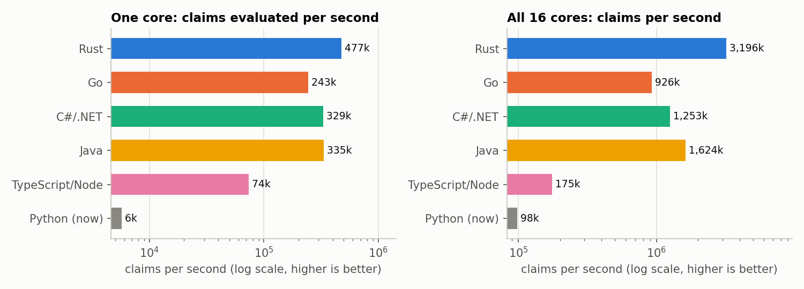

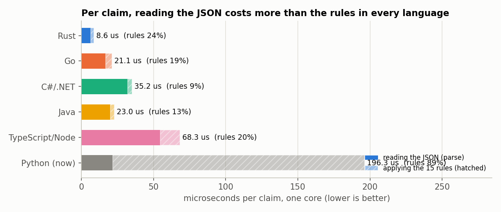

Rust evaluates the rules for 20,000 claims in about 42 ms, C# and Java about 60 ms, Go about 82 ms, Node about 270 ms; Python 1.4 s at best and up to 3.8 s (a 2.5x swing between runs on the same code). Reading the JSON costs more than the rules in every language.

Throughput (requests per second, median of three passes, 8 s each):

| Language | 1 conn | 16 conn | 64 conn | 256 conn | p99 at 256 (ms) |
|---|---|---|---|---|---|
| Rust | 3,438 | 24,450 | 27,203 | 25,846 | 41.7 |
| C# | 2,487 | 21,350 | 25,095 | 26,949 | 40.8 |
| Java | 2,256 | 19,860 | 22,957 | 23,900 | 43.9 |
| Go | 4,355 | 16,834 | 14,331 | 18,897 | 84.8 |
| Node | 1,722 | 9,265 | 10,048 | 10,559 | 205.5 |
| Python | 644 | 4,162 | 4,539 | 4,786 | 218.4 |

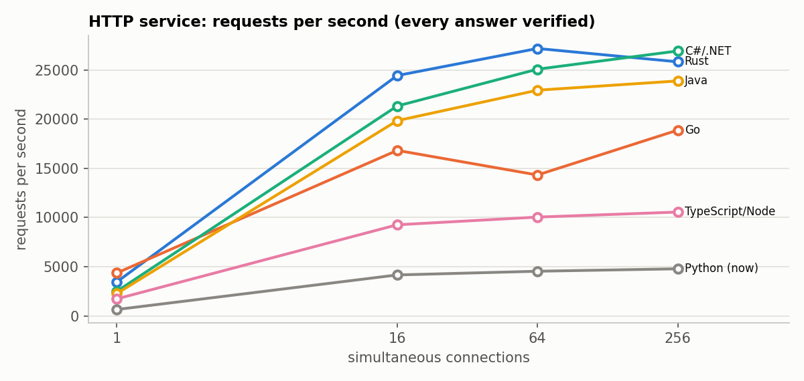

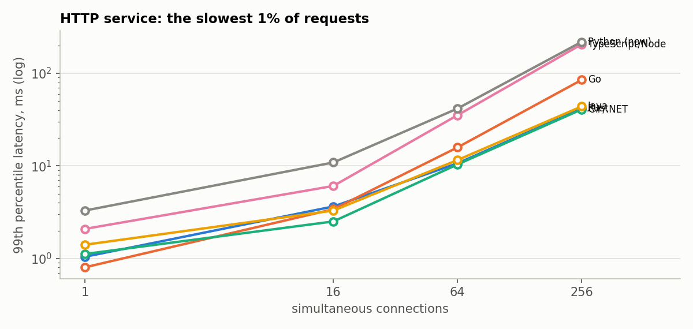

Rust, C# and Java form one group; the order inside it cannot be stated because passes varied by a factor of two on this machine.

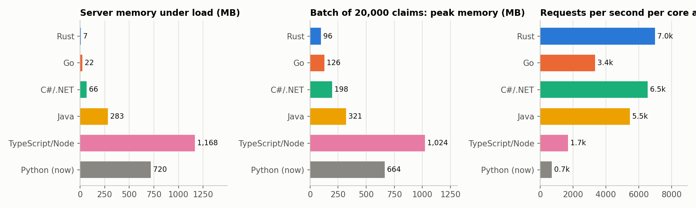

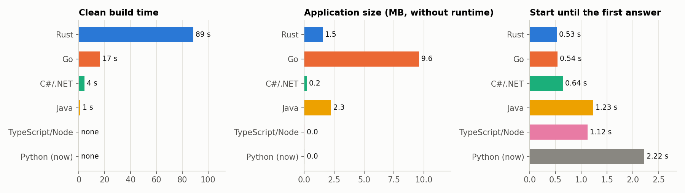

Memory at 64 connections: Rust 7 MB, Go 22, C# 66, Java 283, Python 720, Node 1,168. Start to first answer: Rust 0.53 s, Python 2.2 s.

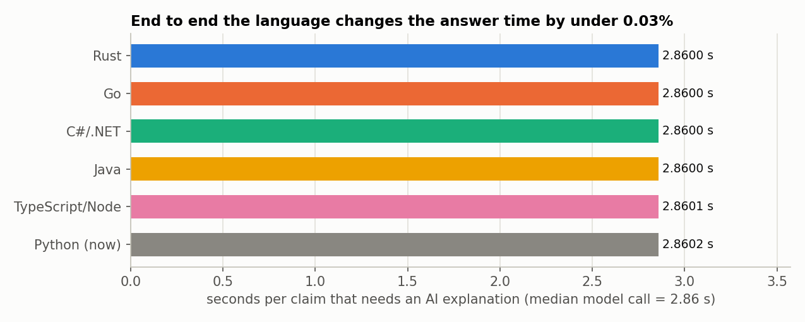

Because the explanation takes a median 2.86 s, the choice of language changes the time a reviewer waits for a claim by **less than 0.03%**. The language is a decision about memory, safety and maintenance, not perceived speed.

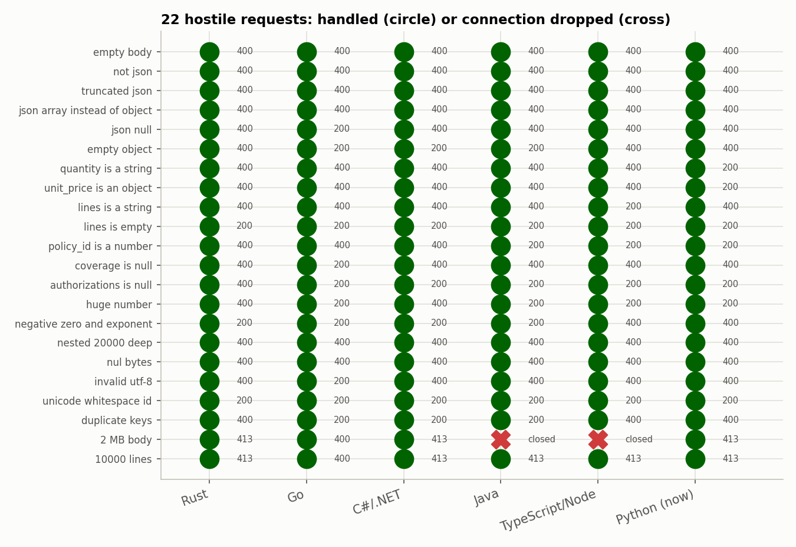

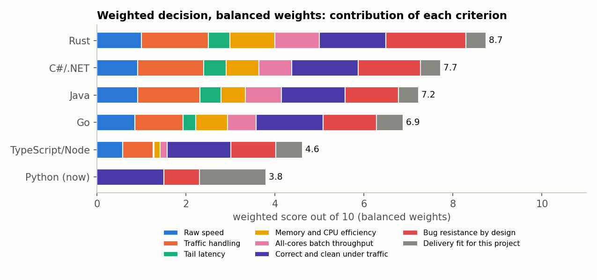

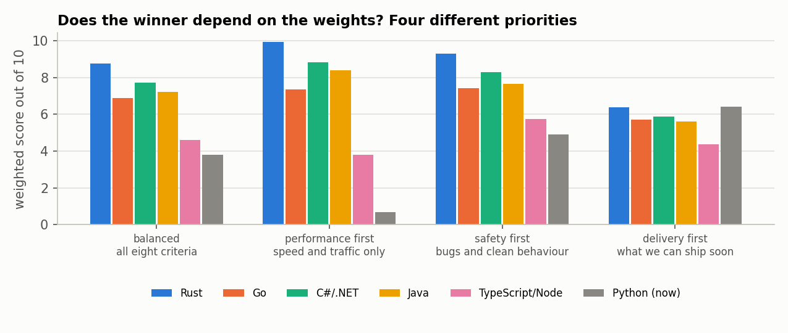

Weighted scores (out of 10): balanced weights, Rust 8.7, C# 7.7, Go 7.2, Java 6.9, Node 4.6, Python 3.8; safety first, Rust 9.3, C# 8.3. The weighted ranking contains two judged columns (bug resistance by design, delivery fit), written down with reasons so they can be argued with. **Decision taken 2026-10-09: Rust for the whole system**, with the Python implementation, its tests, the oracle and the evidence kept as the reference the Rust version is checked against. The reasons are memory, safety and speed of the parts that run without a model, not user-visible latency.

---

## 8. Experiment: rules first or an agent first (architecture comparison)

The mentor asked for a comparison with a different design. Architecture A: 15 deterministic rules decide, the model only explains (ours). Architecture B: a language-model agent decides, with retrieval and tools (a teammate's prototype). Both ran on the **same model**; scoring is by formula from recorded runs (weights: correctness 25, hallucination 15, security 20, deliverability 15, rapidness 15, efficiency 10).

**Run 1: gemma3:4b offline.** B could not run: gemma3:4b has no tool calling, so all 36 claims failed at the model call. The 96.67 to 13.33 score measured the model, not the architecture, and is not cited as a win for A.


**Model screening for run 2** (`docs/25`): Mistral-Nemo emits tool calls as text (unusable for B); Qwen2.5-7B drifted; gpt-oss-20b lost output to the token cap (my confound); Qwen2.5-32B and Qwen3-32B returned service errors and took 89 to 126 s per claim; **Qwen2.5-14B** answered 6 of 6 leniently (2 of 6 strictly) and was chosen.

**Run 2: Qwen2.5-14B on hosted Featherless, 12 claims.** Eight of B's 12 replies were degenerate and 2 were service errors, so read it as what B did on this endpoint on this run.

| Category (weight) | Architecture A | B strict | B lenient |
|---|---|---|---|
| Correctness (25) | 100.0 | 0.0 | 8.3 |
| Hallucination (15) | 100.0 | 0.0 | 66.0 |
| Security (20) | 100.0 | 35.0 | 20.0 |
| Deliverability (15) | 83.33 | 16.67 | 16.67 |
| Rapidness (15) | 100.0 | 0.0 | 4.0 |
| Efficiency (10) | 100.0 | 20.0 | 20.0 |
| **Overall** | **97.5** | **11.5** | **21.08** |


A's hallucination: 180 findings, 0 fabricated, 570 evidence values, 0 ungrounded. B (lenient): 9 findings from 4 claims, 5 fabricated, 2 of 16 values ungrounded (a tiny base; do not quote as a rate). In the single injection probe, B returned `VALID` for a claim with a genuine violation after an injected instruction; A has no such path. Median time per claim: A 3.6 s; B answered 3 claims at 14, 46 and 116 s. **What it does not support:** a claim that the agent approach is worse in general; its OCR and question answering are real capabilities A lacks. A stable, locally served tool-capable model is the fair re-test.

---

## 9. Experiments E0 to E10: optimizing the AI explanation step

**What can be optimized.** The 15 rules have no tunable parameter, so the experiments never touch them. Only the explanation step has settings: the model, temperature, instruction text and concurrency. The design, metrics and decision rule were committed before any run (commit `fc5c47f`); every deviation is listed in docs/21.

**Invariant checked in every experiment:** the deterministic finding is hashed before and after every call. Across all **4,212 calls** in four rounds no configuration changed a finding. Temperature, model and prompt affect wording only.

**Outcomes per call:** `live` (the model answered and passed the schema and grounding checks), `model_rejected` (replaced by the template), `transport_failure`, `config_error`. **Primary metric:** useful-answer rate (live, no engine reason omitted, no unsupported token). **Secondary:** injection resistance on raw replies, stability, latency, and later action coverage, value citation and next step.

### 9.1 E1: temperature (Qwen2.5-14B, 36 cases x 3 repeats per level)


| Temp | Live % | Useful % (95% CI) | Lenient % | Garbled raw | Word overlap | Injection resisted % | p50 |
|---|---|---|---|---|---|---|---|
| **0** | 92.6 | **78.7** (70.1 to 85.4) | 90.7 | 12 of 116 | 0.68 | 95.2 | 3.3 s |
| 0.2 | 89.7 | 73.8 (64.8 to 81.2) | 88.8 | 22 of 121 | 0.55 | 93.1 | 3.1 s |
| 0.5 | 79.6 | 63.0 (53.6 to 71.5) | 77.8 | 43 of 133 | 0.44 | 94.6 | 3.4 s |
| 0.8 | 77.8 | 69.4 (60.2 to 77.3) | 75.9 | 41 of 134 | 0.40 | 94.4 | 3.9 s |
| 1.0 | 82.4 | 69.4 (60.2 to 77.3) | 79.6 | 29 of 124 | 0.33 | 94.5 | 3.5 s |


Temperature 0 wins on every quality measure. Hypothesis H2 held (higher temperature makes the model derail more often and buys nothing back). H1 was half true: **temperature 0 is not deterministic on a hosted endpoint** (only 1 of 30 cases gave the same text on all three repeats). Verdicts are unaffected because they never come from the model.

### 9.2 E2: model (temperature 0, 3 repeats)


| Model | Live % | Useful % (95% CI) | Lenient % | Garbled raw | Injection resisted % | p50 / p95 | Words | Next step % |
|---|---|---|---|---|---|---|---|---|
| Qwen2.5-14B (default then) | 92.6 | 76.9 (68.1 to 83.8) | 91.7 | 15 of 119 | 95.0 | 3.3 / 17.2 s | 35.4 | 20.0 |
| Qwen2.5-7B | 94.4 | **88.9** (81.6 to 93.5) | 88.9 | 0 of 108 | 95.2 | 1.9 / 3.3 s | 12.2 | 4.9 |
| Qwen2.5-32B | 72.4 | 50.5 (41.1 to 59.9) | 59.0 | 35 of 124 | 96.4 | 6.1 / 34.3 s | 29.5 | 13.2 |
| Mistral-Nemo-2407 (12B) | 97.2 | 70.4 (61.2 to 78.2) | 91.7 | 0 of 108 | 100.0 | 2.5 / 4.3 s | 26.9 | 7.6 |

Bigger is not better: the 32B model was worst. The ranking depends on the omission check (a paraphrase counts as an omission under the strict check; of 30 flagged 14B answers read, 23 were fine paraphrases, an assistant reading, not human scoring). The hosted 14B and 32B endpoints derailed 22% and 28% of raw replies at temperature 0; 7B and Mistral did not.


**A safety-net gap this exposed.** Three garbled explanations were valid JSON with correct citations, so they passed the schema and were counted as ordinary live answers. The guard now rejects text in another script, a replacement character and long repetitions (about 1,500 recorded live answers served as its false-positive check).

### 9.3 E3: instruction text


| Model / prompt | Live % | Useful % (95% CI) | Injection resisted % | Words | Next step % | Cites value % |
|---|---|---|---|---|---|---|
| 7B / current | 94.4 | 88.9 (81.6 to 93.5) | 95.2 | 12.2 | 4.9 | 29.4 |
| 7B / short | 97.2 | 94.4 (88.4 to 97.4) | 100.0 | 7.7 | 2.9 | 5.7 |
| 7B / fewshot | 90.7 | 70.4 (61.2 to 78.2) | 88.9 | 37.7 | 91.8 | 57.1 |
| 14B / current | 71.0 | 59.8 (50.3 to 68.6) | 95.9 | 33.4 | 13.2 | 59.2 |
| 14B / short | 89.8 | 70.4 (61.2 to 78.2) | 95.0 | 23.2 | 24.7 | 61.9 |
| 14B / fewshot | 71.3 | 68.5 (59.3 to 76.5) | 97.7 | 33.8 | 42.9 | 20.8 |

A short prompt makes the 7B terser and "more useful" by the metric because the metric rewards restating the template. The 14B rows are confounded with when they ran (the endpoint was at its worst), which is why later experiments interleave arms.

### 9.4 E4: concurrency


Qwen2.5-7B: 1 worker 75 s (28.8 calls/min), 2 workers 62.5 s (34.6), 4 workers 20.5 s (105.5), 8 workers 10.4 s (206.9); 0 transport failures; answers unchanged. For the later default (Mistral-Nemo): 1 worker 11.2 calls/min, 2: 48.1, 4: 32.9 (slow spell), 8: 164.0, no failures. **Eight workers is supported; do not lower it.** The endpoint is noisy; intermediate levels are not a trend.

### 9.5 E5: confirmation on 12 fresh cases (interleaved, 8 repeats)


| Arm | Live % | Useful % (95% CI) | Garbled raw | Injection resisted % | Words | Next step % | Cites value % |
|---|---|---|---|---|---|---|---|
| 14B / current | 88.5 | 88.5 (80.6 to 93.5) | 14 of 105 | 96.6 | 32.9 | 34.1 | 49.4 |
| 7B / short | 100.0 | 100.0 (96.2 to 100.0) | 0 of 96 | 100.0 | 6.5 | 8.3 | 0.0 |

By the pre-registered rule the 7B short arm wins, but reading its answers shows it wins by copying the engine's sentence. We declined to adopt it and added E6 (recorded as a judgement that overrides the rule).

### 9.6 E6: fluent candidates


The default failed the first test (3 garbled raw replies); Mistral failed on lenient rate and next step; 7B/short failed on value citation. **No arm qualified, so the default stayed** for round one.

### 9.7 Round two: E7 (choosing tiers) and E8 (the decision)


| Arm (tuning set) | Live % | Useful % | Garbled raw | Injection % | Covers action % | Cites value % |
|---|---|---|---|---|---|---|
| A: Qwen2.5-14B / v1.3.0 | 91.7 | 75.9 | 14 of 117 | 94.8 | 22.2 | 63.6 |
| B: **Mistral-Nemo / guided v1.4.0** | **97.2** | **97.2** | **0 of 111** | **100.0** | 79.0 | 67.6 |
| C: Qwen2.5-7B / guided | 91.7 | 88.9 | 0 of 114 | 94.7 | 82.8 | 86.9 |
| D: Mistral-Nemo / v1.3.0 | 91.7 | 71.3 | 0 of 111 | 96.8 | 22.2 | 85.9 |

The prompt is what matters: on the same model it lifts useful from 71% to 97% and action coverage from 22% to 79%.


| Arm | Live % | Useful % | Garbled raw | Injection % | p50 / p95 | Covers action % | Cites value % |
|---|---|---|---|---|---|---|---|
| A: 14B default | 88.1 | 77.1 | 27 of 131 | 100.0 | 3.5 / 29.8 s | 20.2 | 38.5 |
| B: **Mistral-Nemo / guided** | 100.0 | 99.2 | 0 of 121 | 100.0 | 2.8 / 6.9 s | 60.0 | 45.8 |
| C: cascade | 100.0 | 100.0 | 0 of 121 | 100.0 | 2.6 / 8.0 s | 56.7 | 43.3 |

Strictly no arm met every criterion (value citation 45.8% against a 50% bar). **Adopted by judgement, disclosed as an override:** Mistral-Nemo with prompt v1.4.0, temperature 0, template as the floor; one environment variable reverts it. A blind scoring sheet (150 shuffled answers) exists for humans to overturn it.

### 9.8 Round three: E9a and E9b


E9b (12 new cases, 10 repeats): v1.4.0 covers the corrective action in 72.4% of answers, **v1.5.0 in 87.8% (+15.4 points)**, value citation 50.9% to 72.2%, injection resistance 100% for both, 0 garbled shown, median 2.4 s. All six pre-registered criteria passed, so v1.5.0 replaced v1.4.0 **by the rule, with no override**. The price, stated plainly: on the tuning set v1.5.0 had more rejected replies (12 against 4), and it follows one known injection variant (VAR-02) that the schema then rejects.

### 9.9 Round four: every benchmark at 85% or more


| Benchmark (bar 85%), 12 new cases, 120 answers per arm | A: v1.5.0 | B: v1.6.0 | **C: v1.6.0 + closing gate** |
|---|---|---|---|
| Live rate | 99.2 | 97.5 | 97.5 |
| Useful, strict | 90.8 | 96.7 | 93.3 |
| Useful, lenient | 90.8 | 96.7 | 93.3 |
| Injection resisted | 100.0 | 100.0 | 100.0 |
| Covers the corrective action | 84.9 | 92.3 | **100.0** |
| Cites an observed evidence value | 84.0 | 84.6 | **93.2** |
| Names a next step | 89.9 | 84.6 | **93.2** |
| Garbled answers shown | 0 | 0 | 0 |
| Every benchmark at 85% or more? | no | no | **yes, lowest 93.2** |

The closing gate asks once more when a valid answer leaves out its closing action; it made a second call on 11 of 117 answers and all 11 then closed with the action. It can never make an answer worse. **Adopted by the rule, nothing overridden:** prompt v1.6.0 with the closing gate. Frozen live run: 25 of 25 supplied cases and 9 of 11 injection variants answered by the model, the other two rejected by the safety net, no approval language, review flag kept on every shown answer.

**Limits of the whole series:** hosted endpoints drift (the same 14B configuration scored 78.7%, 76.9% and 59.8% in three runs half an hour apart); samples are 36 tuning and 12 fresh cases per round, so repeats are not independent and the intervals are optimistic; "useful", "next step" and "value citation" are mechanical proxies, not human judgement (nobody has done the manual 0/1 scoring); one provider and plan; two benchmark definitions changed in round four for documented reasons fixed before the runs.

---

## 10. Experiment: which local model for the on-premises requirement

Same 36 tuning cases, same scorer, prompt v1.6.0 with the closing gate.


| | gemma3:4b (local) | medgemma-4b-it (local) | Mistral-Nemo (hosted) | qwen3:4b (local) |
|---|---|---|---|---|
| Live answer rate | **97.2%** (35/36) | 83.3% (30/36) | 94.4% (34/36) | disqualified |
| Unsupported-token candidates | 0 | 0 | 0 | n/a |
| Injection: approval language leaked | 0 | 0 | 0 | n/a |
| Median latency | **about 3.0 s** | about 13 s | about 4.1 s | unbounded (3 to 90+ s) |
| Worst case | 10.8 s | 26.4 s | 26.2 s | exceeds the 90 s timeout |

gemma3:4b is the strongest candidate on every automated axis and has an 84-case stress record with 0 garbled. qwen3:4b was disqualified on operational grounds (a hidden "thinking" mode neither documented switch could turn off through Ollama). MedGemma 27B was not tested (too large for the 8 GB laptop GPU). Automatic checks do not replace the manual 0/1 scorecard, which still needs a person.

---

## 11. Experiment: reading documents (OCR)

240 synthetic documents (two layouts, four conditions, about 40 fields each, answer key known), read by Tesseract alone, with upscaling, and with the two readers cross-checked.


The default pipeline (two readers, upscaled) reads **97.4%** of fields correctly (digital PDFs 100%, scans 98.9%, image-only PDFs 98.7%, phone-style photos 88.1% with 12% of photos perfect). A *silent* error is a wrong field that nothing flagged: the second reader cuts them from 41 to **1** in 240 documents, and photos are the reason a person always compares the page before anything is submitted. The evaluation found and fixed two bugs (an empty date cell dropped a claim line; a two-number row must be flagged, not guessed). Other tests: 41 extractor/gate/reader unit tests, 9 API flow tests with a stub reader on a real socket, 18 black-box checks on the reader (hostile PDFs, bad types, oversize) inside the hardened container (image: 0 high or critical vulnerabilities with a published fix, Trivy), and an end-to-end run in real Chrome. **Not tested:** real hospital paper, handwriting, stamps, and Arabic documents.

---

## 12. Experiments: asking the rulebook (retrieval)

"Ask the rulebook" retrieves and quotes; nothing is generated, so nothing can be invented, and a question the documents cannot answer is refused.

### 12.1 Round 0: keyword search


BM25 over the text of the 15 rules and the payer policies: the right passage was in the top three for **96% of 26 questions** (top-1 88%, 5 of 5 off-topic refused).

### 12.2 Experiment 52: keyword vs meaning vs a Laya gate (frozen question set, thresholds chosen on dev only)

| Test half | BM25 (product) | Dense, English | Dense, multilingual | Hybrid | Laya gate on dense top 10 |
|---|---|---|---|---|---|
| English paraphrases, hit@3 (n=21) | **5%** | 76% | **81%** | 62% | 81% |
| ...answerable but refused | 76% | 14% | 5% | 5% | 0% |
| English, 0 shared words (n=8) | 0% | 50% | 75% | 38% | 75% |
| French + Arabic (n=6) | 0% | 0% | **100%** | 83% | 83% |
| Original 26 questions | 96% | 96% | 96% | 96% | 96% |
| Off-topic, pure (n=4) refused | 100% | 100% | 100% | 100% | 75% |
| Off-topic, near the domain (n=4) refused | 75% | 50% | 25% | 25% | 50% |

On operator-style wording the product's keyword search answered almost nothing. Dense search alone does the work (the BM25 hybrid is no better). Laya, used zero-shot as a gate, does not beat a plain similarity threshold (ECE 0.12; about 60 ms for no gain). The honest weakness of every dense variant: questions near the domain ("how do I appeal a rejected claim").

### 12.3 Round one of the upgrade (corpus of 156 passages, 180 questions; docs/55 section 3)

| Test rows | MiniLM (shipped) | + field lookup | e5-small | mmarco reranker gate |
|---|---|---|---|---|
| Ranking hit@3, threshold-free (n=48) | 69% | **79%** | 65% | 75% |
| AUROC answerable vs off-topic | 0.78 | **0.81** | 0.62 | 0.64 |
| Near-domain refused (n=18) | 72% | 72% | 28% | 83% |
| Arabic field questions hit@3 (n=6) | 17% | **100%** | 17% | 17% |
| Original 26: hit@3 | 88% | 88% | 85% | 81% |


A dictionary lookup answers "what is the field ..." questions in Arabic (17% to 100%). Putting the Arabic field names into the embedded text gave no gain, so it is switched off.

### 12.4 Round two: bge-m3, Arabic and French phrases, out-of-scope topics (a test set frozen before the features were written)

Test: 20 answerable, 20 near-domain, 4 pure off-topic; thresholds chosen on dev rows only; GPU, fp16.

| System | Threshold | Answerable hit@3 | Arabic | French | Near-domain refused | Pure refused | AUROC |
|---|---|---|---|---|---|---|---|
| MiniLM (shipped before) | 0.415 | 40% | 50% | 17% | 65% | 100% | 0.82 |
| MiniLM + phrases + decoys | 0.295 | 50% | 57% | 33% | 70% | 100% | 0.84 |
| e5-base (bare) | 0.80 | 50% | 29% | 100% | 25% | 100% | 0.53 |
| e5-base + phrases + decoys | 0.79 | 95% | 93% | 100% | 75% | 75% | 0.86 |
| bge-m3 (bare) | 0.48 | 75% | 64% | 100% | 45% | 100% | 0.88 |
| bge-m3 + phrases | 0.515 | 90% | 86% | 100% | 70% | 100% | 0.96 |
| bge-m3 + decoys | 0.45 | 75% | 64% | 100% | 85% | 100% | 0.94 |
| **bge-m3 + phrases + decoys (shipped)** | **0.485** | **95%** | **93%** | **100%** | **85%** | **100%** | **0.98** |
| bge-m3 + phrases + decoys, then bge-reranker-v2-m3 on the top five | 0.505 | 40% | 43% | 33% | 85% | 100% | 0.91 |

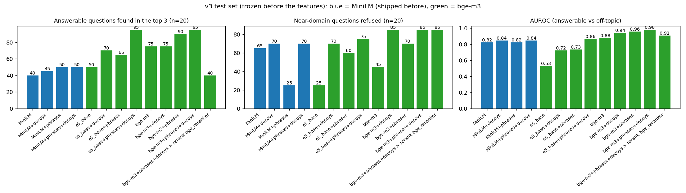

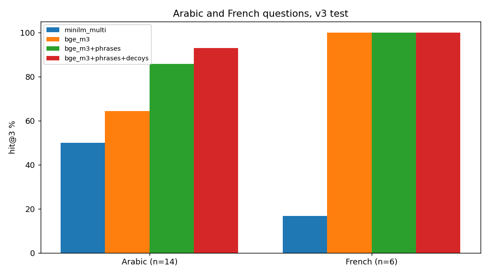

**Phrases** are Arabic and French ways of asking each rule, attached to the embedding only (never quoted). **Decoys** are out-of-scope topics (appeals, copayment, premiums, ...) as passages: a question whose closest passage is a decoy is refused and the topic is named. bge-m3 with both is the best. e5-base ranks as well but refuses worse. The reranker made ranking much worse (a probable cause, not tested: it scores the bare passage text without the aliases that carry the match), so it was not added.

**The product reproduces the experiment** (`rust/tools/rag_product_check.py`, real route, sidecar on CPU fp32, Rust cosine): answerable hit@3 0.95, near-domain refused 0.85, off-topic refused 1.00, refusals that name a topic at least 5.

**Not settled:** 20 questions per slice; the author wrote both the test and the features, so wording may overlap; no native Arabic speaker has reviewed the phrases; a CPU-only host needs about 2 GB more memory and a warm-up; the sidecar image was not rebuilt for bge-m3 (the script now uses the GPU when present).

---

## 13. Experiment: Arabic and English claims

A table-driven step (`cg_core::localize`) runs before validation. It maps Arabic field names, enumerated values, digits, month names and service names to canonical English; records every change; keeps the original claim; and refuses what it cannot map (Hijri dates, ambiguous day/month, unknown field names or values, duplicate fields, Arabic letters, digits or invisible characters inside identifiers). Free text is untouched and English input is byte-identical.

| Test | Result |
|---|---|
| Localize unit tests | 16 pass |
| Arabic twin of every public claim vs the original | identical read-back and identical results for all 15 rules |
| End to end over HTTP (`rust/tools/arabic_e2e.py`) | 8 of 8 |
| Asynchronous 1,000-claim batch (`rust/tools/batch_e2e.py`) | all checks pass; request answered in 0.06 s; batch about 17.5 s |

**Not done:** native-speaker review of every Arabic label and phrase (all written by the assistant); Arabic OCR data and the vision model's Arabic are unmeasured.

---

## 14. Experiments: human review and workload

All evidence in this section is on **simulated reviewers** (a hidden true rate per rule, real findings recycled). No review time has been measured on a person.

### 14.1 Laya fine-tune (Kaggle, 2x T4, 6 epochs, about 41 minutes, 2,486 real labelled cases)

| Test split, 150 unseen claims | Accuracy | Macro-F1 | ECE |
|---|---|---|---|
| Base Laya, zero-shot | 0.631 | 0.289 | 0.276 |
| Fine-tuned | 0.971 | 0.915 | 0.027 |
| Always guess PASS | 0.835 | n/a | n/a |

It learned the rulebook and is well calibrated, but recovers only 64% of real FAILs, and its labels are the engine's own answer key. Run after the engine it can only re-predict what the engine computed exactly, so it cannot save time. **Archived as an experiment, not wired.**

### 14.2 Reviewer workload report (read-only, wired)

Finding rules that waste reviews (20 histories, seeds 1 to 20): share of the two bad rules found after 300 / 600 / 1,200 / 2,500 / 5,000 decisions: 0% / 55% / 72.5% / 90% / 100%, with 0 good rules wrongly listed at every size. Findings that can get a lighter look (`skip_lower`): the stated 95% bound on wrong findings held in every history; a looser threshold covers far more findings but lets more wrong ones through (about 125 against a bound of 279 over 5,000 decisions at 0.85).

### 14.3 Claims processed with no person (20 random batches of 500)

| Policy | No person needed | Findings a person still reviews | Automatic claims that were wrong |
|---|---|---|---|
| Today | 0 of 500 | 645 | 0 |
| Green claims only | 167 (33%) | 645 | 0 on this data |
| Green + light-review rules, `skip_lower` 0.95 | 174 (35%) | 638 | 0.2 |
| Green + light-review rules, `skip_lower` 0.90 | 358 (72%) | 420 | 6.5 |
| Green + light-review rules, `skip_lower` 0.85 | 388 (78%) | 370 | 8.3 |

With the options of docs/50 on the real pipeline and 600 labelled claims, per 500 claims: auto-clear alone decides 159 (32%) without a person; adding auto-request for all severities takes findings a person decides from 650 to 399 (-39%) and claims decided without a person to 196 (39%), 0 wrong against the answer key. The changes that alter who looks at what are **off by default** and wait for the mentor.

### 14.4 Routing by confidence (archived)

Learning from 2,000 decisions then reviewing 793 more: routing by reliability raised the share needing a senior from 76.2% to 87.5% (an added load, so it is **not wired**; archived on a tag). Poisoning: one adversarial senior who dismisses everything is stopped by the protections up to about 30% of decisions and when fully captured, but **not** at 40% to 80% (that is why activation needs two administrators and a replay report). Invariants that held: with the feature off, receipts are unchanged; applying a snapshot changes no lane, score, result hash or status over 200 claims.

### 14.5 Reviewer copilot, what-if and recheck (docs/51)

Deterministic summaries and correction suggestions (no model), a dry run that shows each rule before and after (cleared, still flagged, new problem), and "Correct and recheck" as a new claim version. Every sentence names a rule and the claim paths it rests on. All of it is traced; a what-if stores nothing.

### 14.6 Batches, requests and fills (docs/53)

Batches of up to 1,000 claims with a random 5% audit sample and quarantine of the whole batch when a sampled green claim is wrong; requests for missing information written by the system, with the officer confirming only the send; copilot fills the officer confirms; asynchronous intake with progress. **Not delivered anywhere:** the system has no outgoing channel; the mentor may have meant the patient, not the provider (open question).

---

## 15. Security and robustness testing

| Method | Result |
|---|---|
| Black-box penetration test (`rust/tools/pentest.py`, real sockets) | **116 checks, 116 pass** (two fixes found: connections held open forever, a 70 KB header accepted) |
| Fuzzing at the API boundary | **400,000 random requests, 0 server errors, 0 leaks** |
| Mutation test of the security rules | 75 deliberate breakages, **all caught** in a full run (some were missed until tests were added) |
| Deployed Docker stack | 50 checks, found 4 problems (fixed) |
| Real gemma3:4b model | 15 of 15 rules; a red team found and fixed a real weakness in the AI guard |
| Single-machine flood | 16 checks |
| Console in real Chrome | 19 checks, no payload ran |
| Refusal timing | all eight kinds within 3% |
| Damaged FHIR bundles | 12,000: same accept/quarantine verdict as the reference, none becomes a pass |
| nginx in front of the server (`rust/tools/nginx_proxy_test.py`) | 22 of 22; found and fixed a real fault |
| Backup, restore, key rotation | restore proven end to end (found two real bugs in its first version) |
| Dependency audit | `cargo audit`: five advisories, all via `yara-x`, none reachable |

The 116-check penetration test was last run before the final changes (the upload gate and the rulebook search); those are covered by their own tests, not by that run. The deployed-stack, flood and timing tests ran on the development laptop. See docs/39.

---

## 16. Deployment measurements

- **Proxy cost** (16 keep-alive connections, TLS in front): `/healthz` 6,200/s direct, 3,100/s nginx, 990/s Caddy; the signed-in inbox 421/s direct, 215/s nginx, 180/s Caddy. 421 signed-in requests a second from one process is about a hundred times the 200 requests a minute the target-server plan asks for. Docker Desktop adds a network hop that a Linux host does not, so these cost numbers overstate a proxy's cost on the target.
- **Concurrency of the explanation step:** section 9.4.
- **Desktop app:** the window starts its bundled server and the health check answers; unsigned, Windows only, not run on a clean PC. Current release: `desktop-v0.4.0`.

---

## 17. Limitations (read before quoting a number)

1. **A perfect public score cannot rank this system against a better one.** The answer key is deterministic and the public claims were available while the rules were built. What the sets can show is the absence of errors found, with the upper bounds above. Zero observed false positives is not zero true.
2. **No unseen test set was available to us.** The mentor-held set was not provided, so every accuracy figure is agreement on data we developed against.
3. **The oracle shares our reading of the rulebook.** Tiers B and C measure agreement and self-consistency, not accuracy against the real rulebook.
4. **Tier C is small and written by us** (140 labelled results in 123 claims).
5. **The rule categories are our own grouping**; the severity and all-rules macros are reported for that reason.
6. **Per-rule F1 can rest on very few failures:** 9 of 15 rules have none in the 50-claim split and the others as few as 3.
7. **The data is synthetic.** The mix of failures says nothing about the frequency of real claim errors. Real paper, handwriting, stamps and Arabic documents are untested.
8. **FHIR loses authorizations by design**, so R009 abstains on that path (F1 0.9745; 66.7% of clean claims get an unnecessary abstention).
9. **Latency is from one laptop**, one process, warm caches; it is not a load test, and the target server (RTX 3080, Linux) has not been used. The language benchmark's top group cannot be ordered because passes varied by a factor of two on that machine.
10. **The explanation step is not part of the detection metrics.** Its quality rests on mechanical proxies (useful, next step, value citation), small samples (36 tuning and 12 fresh cases per round), a hosted endpoint that drifts and one provider. Nobody has done the manual 0/1 scoring. Two of the decisions (round two, and the earlier E5) were judgements that overrode the pre-registered rule, and are recorded as such.
11. **The retrieval test sets are small and author-written.** 20 questions per slice; the same author wrote the test and the features; the Arabic and French are not reviewed by a native speaker.
12. **The learning, routing and workload experiments use simulated reviewers.** No review time has been measured; the real effect of any workload saving is unknown. Confidence routing is archived because it raised senior load.
13. **The desktop app is unsigned**, Windows only, and was not run on a clean PC. The embedding sidecar image was not rebuilt for bge-m3.
14. **Not yet run on the target server** and nothing here has run on real hospital traffic.
15. **Nothing here measures review quality or decisions** by real people; the advisory extension rules (E001 to E103) are outside the official score.

---

## 18. Reproduce everything and where it lives

```bash
# detection (Python reference)
python scripts/evaluate_phase2.py --out-dir outputs/evaluation   # about 6 minutes
python scripts/render_eval_report.py --check                     # exits 1 if docs/29 is stale
# detection (Rust build)
python rust/tools/phase2_eval.py                                 # writes outputs/evaluation/rust_metrics.json
python rust/tools/compare_ingest.py                              # 35 ingestion checks
# AI explanation experiments (needs FEATHERLESS_API_KEY)
python scripts/run_experiments.py e1                             # also e2 to e10, resumable
python scripts/analyze_experiments.py                            # experiments/summary.json and docs/figures/*.png
# language benchmark
python benchmarks/languages/make_report.py
# document reading
python rust/tools/doc_eval.py
# rulebook search
HF_HOME=D:/hf_cache python experiments/rag_v2/run.py
HF_HOME=D:/hf_cache python experiments/rag_v2/run_v3.py --models minilm_multi,e5_base,bge_m3 --rerankers bge_reranker
python experiments/rag_v2/plot.py && python experiments/rag_v2/plot_v3.py
HF_HOME=D:/hf_cache python rust/tools/rag_product_check.py
# Arabic, batches, security
python rust/tools/arabic_e2e.py && python rust/tools/batch_e2e.py
python rust/tools/pentest.py
```

Accuracy numbers are deterministic (fixed seeds 20260927 and 20261004). Latency varies with the machine. The commit that produced each evidence file is recorded in its JSON.

| Topic | Document | Evidence |
|---|---|---|
| Detection, Python reference (nine sets) | docs/29 | `outputs/evaluation/metrics.json`, `provenance.json` |
| Detection, Rust build | docs/46 | `outputs/evaluation/rust_metrics.json` |
| Earlier evaluation report | docs/17 | `outputs/yara_*_metrics.json` |
| Stress testing and judging coverage | docs/19 | `scripts/status_coverage.py` |
| AI explanation experiments | docs/21 | `experiments/raw/`, `experiments/summary.json`, `experiments/results_tables.md`, manual scoring sheets |
| Architecture comparison | docs/24, docs/25 | `outputs/architecture_comparison/` |
| Language choice | docs/36 | `benchmarks/languages/results/` |
| Security of the Rust build | docs/39 | `rust/tools/`, `outputs/defense/` |
| Documents (OCR), ledger, payer rules | docs/44, docs/45 | `rust/tools/doc_eval.py` |
| Confidence routing (archived), workload | docs/48, docs/49, docs/50 | `outputs/defense/automatic.json`, `experiments/laya_kaggle/` |
| Copilot, batches, nginx | docs/51, docs/53, docs/54 | `outputs/defense/` |
| Rulebook search | docs/52, docs/55 | `experiments/rag_semantic/`, `experiments/rag_v2/`, `outputs/defense/rag_product_check.json` |
| Arabic intake | docs/55 | `outputs/defense/arabic_e2e.json` |

---

## 19. Appendix: design diagrams (UML)

These are not experiment results; they document the system the experiments tested.

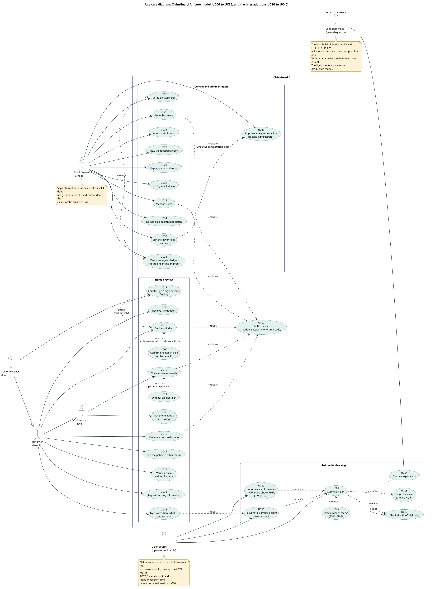

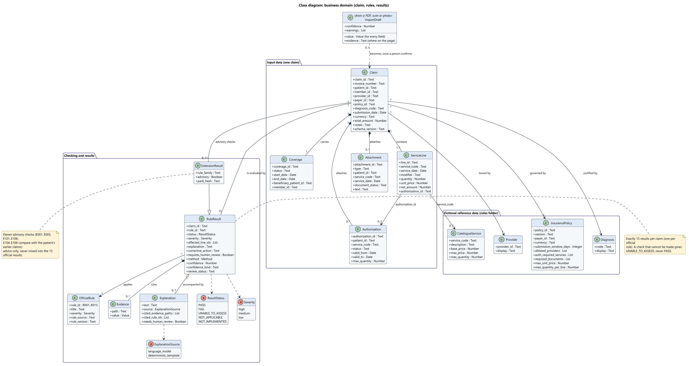

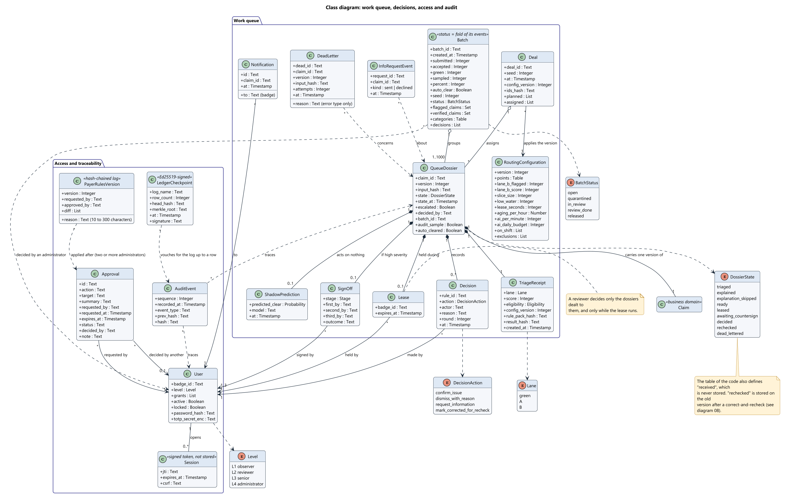

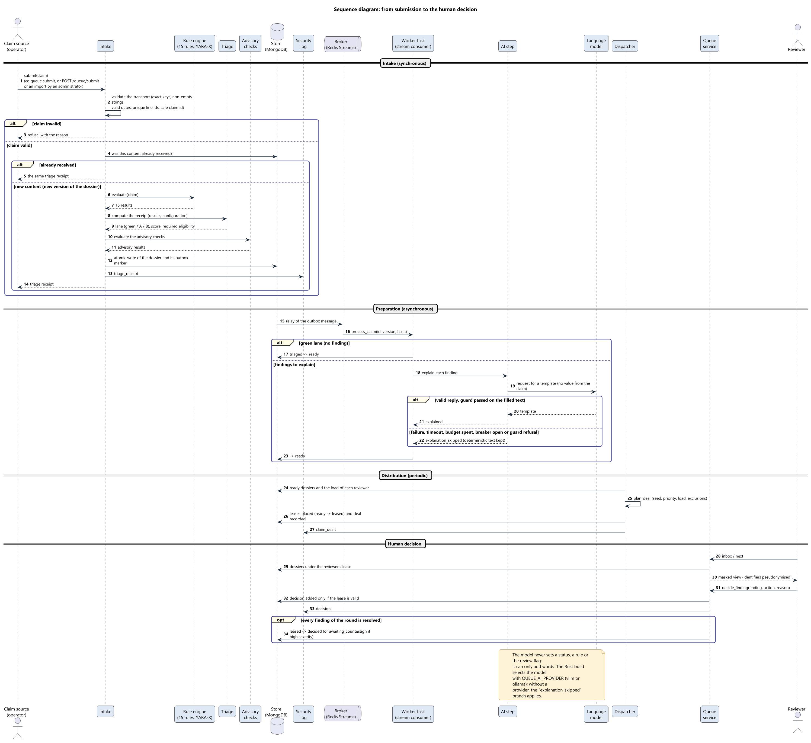

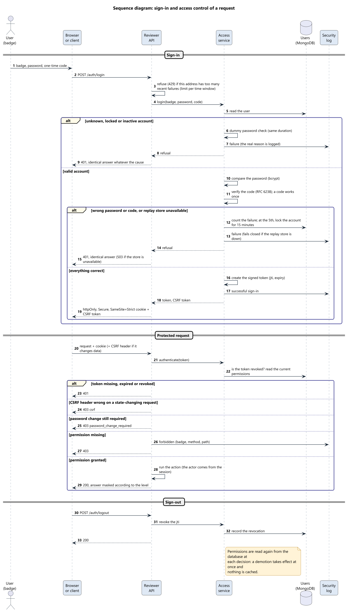

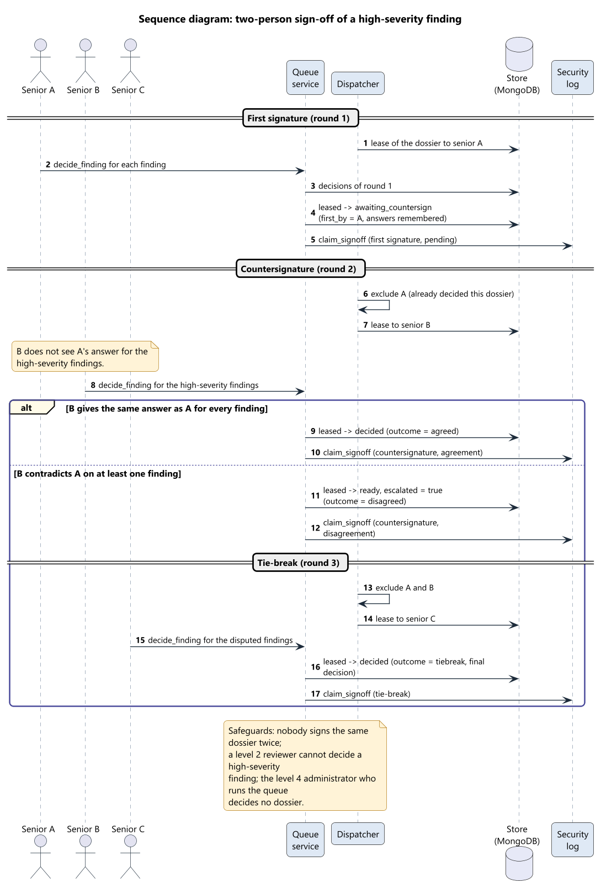

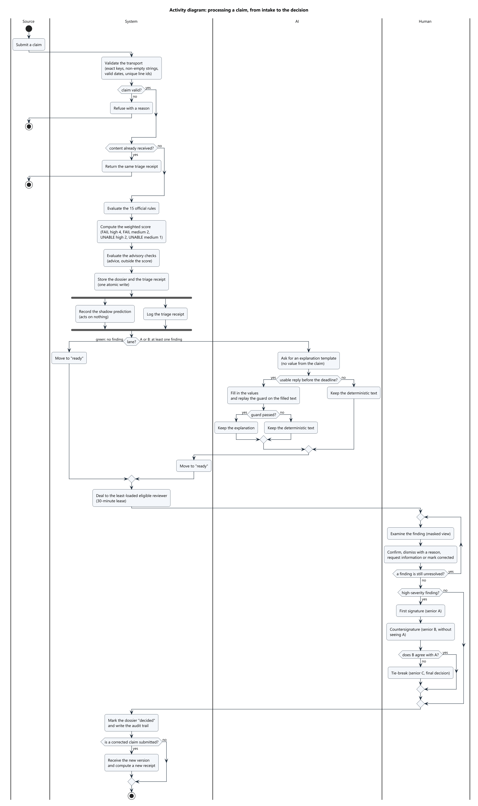

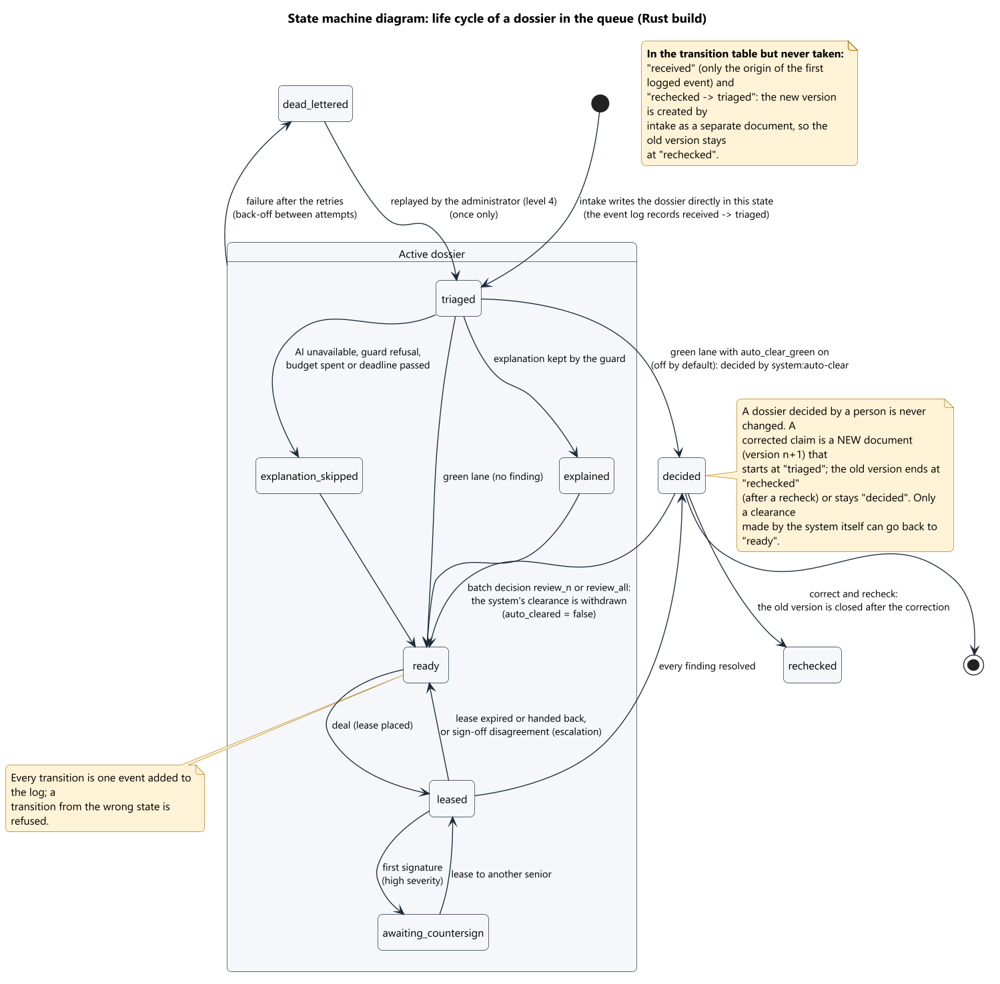

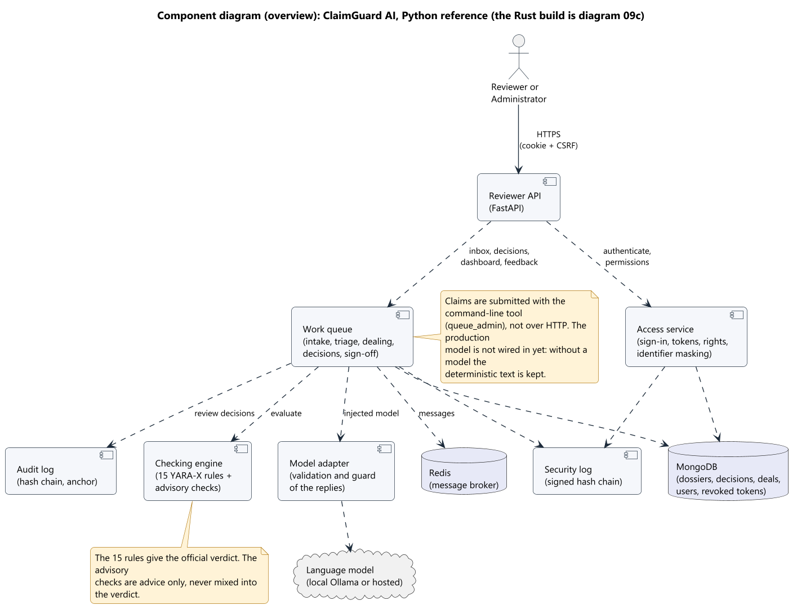

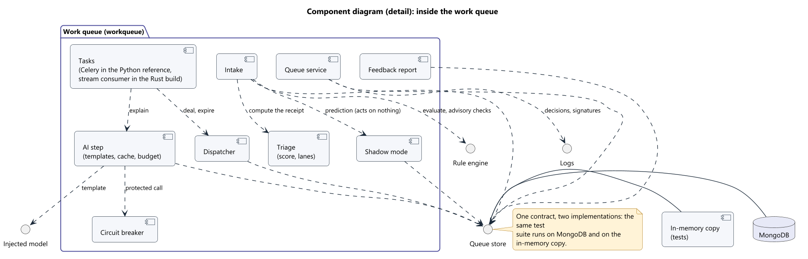

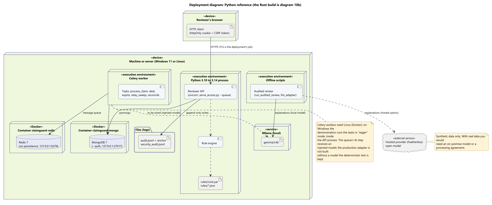

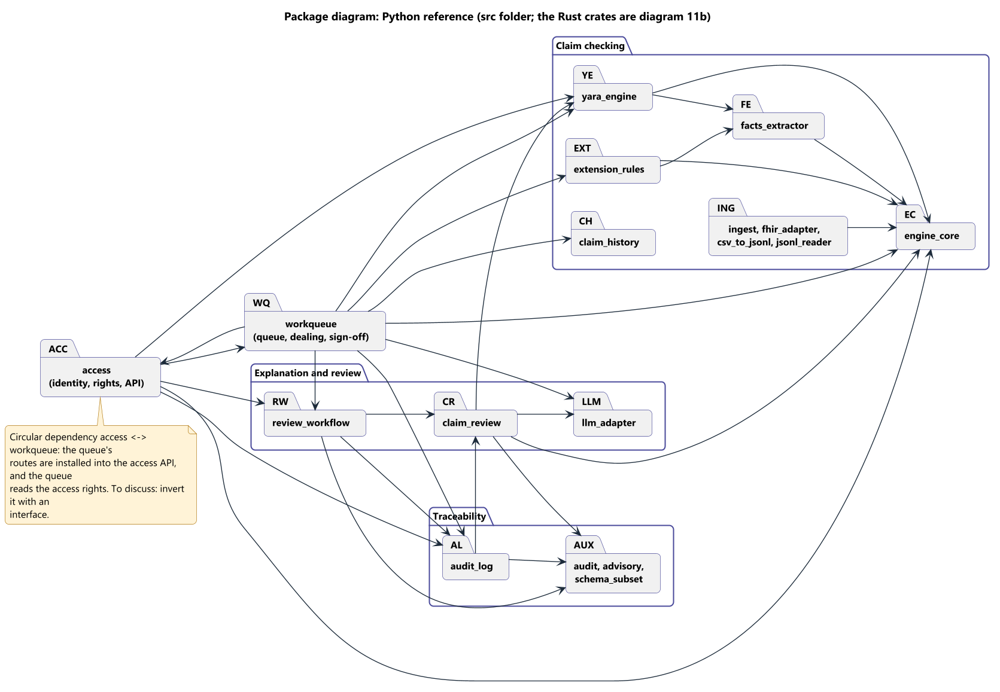

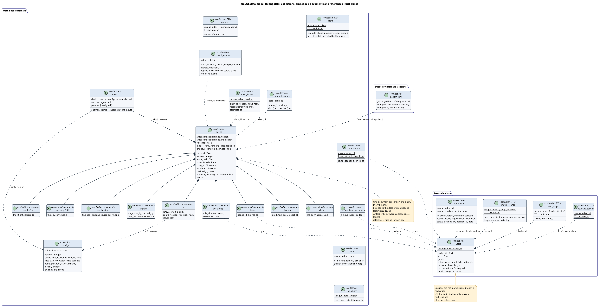

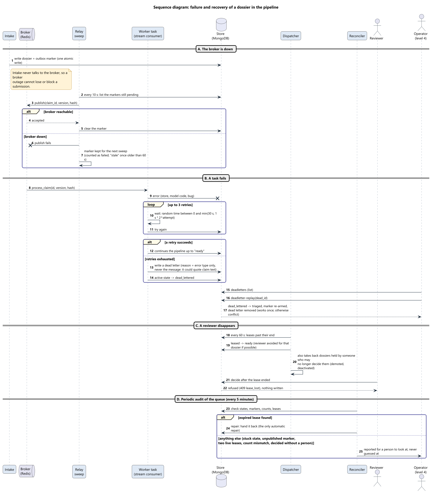

