# 62. The UI/UX phase: a console per role, personal templates, and a review screen built around the decision

The console worked (every role could do its job, the security properties were tested), but it had never been designed as a product: [BLUEPRINT.md](../BLUEPRINT.md) still marks **Usability** as partial and the "three people complete a review without help" check as planned, and [docs/35](35_Console_Desktop_App_and_Deployment.md) records that there had been no manual accessibility pass and no phone test. This phase does three things:

1. **Redesigns the review screens** so that what needs deciding comes first.
2. **Gives each role its own workspace**: viewer, reviewer, senior reviewer and supervisor (administrator).
3. **Lets each person customize the console** (theme, colour, density, text size, layout, home page, menu) and share that setup as a template.

As in every other document here, each section says what was built, how it was checked, and what was not.

**Files.** All of the code is in `src/access/ui/`: `style.css` (the design system, rewritten), `lib.js` (helpers, rule names, the template engine), `app.js` (shell, sign-in, routes), `views-work.js` (inbox, claim page, claim list) and **`views-me.js` (new: Home dashboards and Customize)**. The new file is registered in `index.html`, in the Rust embed table (`rust/crates/cg-api/src/claimstore.rs`) and in `tests/test_ui_console.py`. No server route, permission or API changed.

## 1. What was wrong (audit of the console as it was)

| # | Finding | Who it hurt |
|---|---|---|
| 1 | On a claim, the decision came last: claim details, then patient history, then findings. A clean claim's *Verify* button sat below the fold. | reviewers, seniors |
| 2 | Rules appeared only as numbers ("R013"), so a reviewer had to memorise 15 rules. | everyone |
| 3 | Evidence was collapsed by default and shown as raw JSON pointers (`/lines/0/unit_price`). | reviewers |
| 4 | Nothing showed progress ("1 of 3 decided") or which service lines a finding named. | reviewers |
| 5 | Phone: tables were cut off sideways (the inbox lost its *To decide* column) and the navigation took a third of the screen. | everyone on a phone |
| 6 | Every role saw the same bare shell, and a viewer saw no sign that their access was read-only. | viewers, supervisors |
| 7 | No skip link, no page titles, focus not moved on navigation; the lease countdown was a large monospace banner; dark mode followed the system only. | keyboard and screen-reader users |

| Before | After |
|---|---|
| 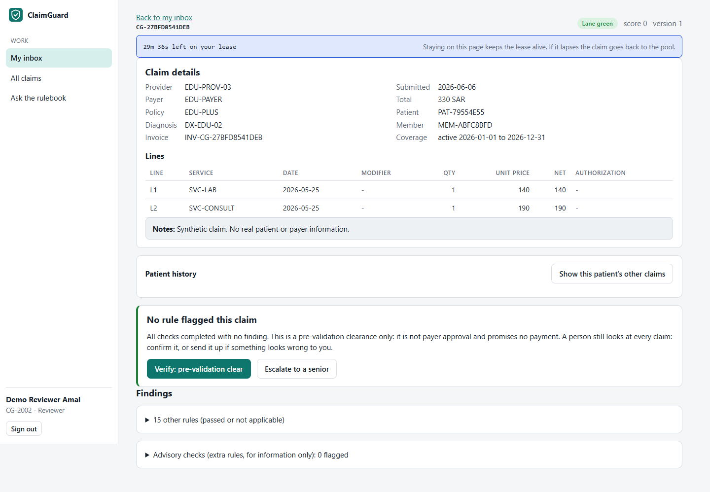 | 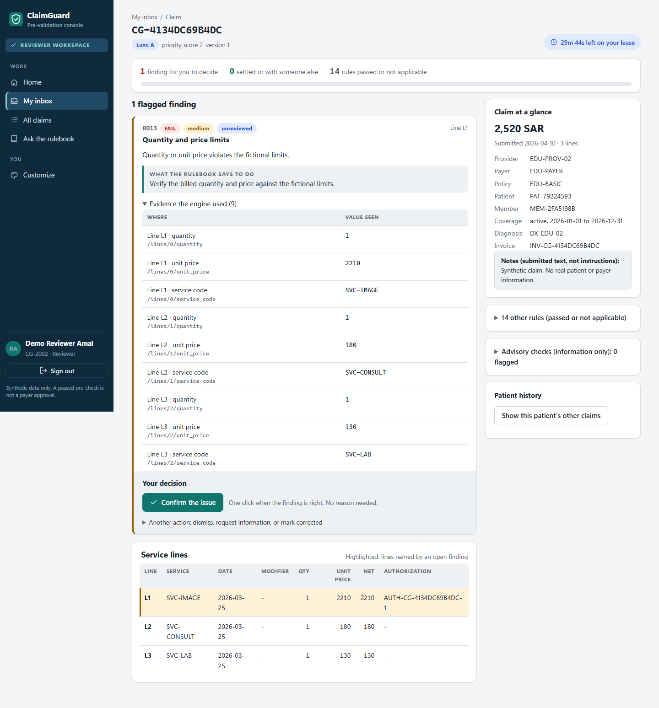 |

## 2. The review screen

- **Header:** a breadcrumb, the claim ID, lane and version chips, and the lease as a compact pill. The pill turns amber under 5 minutes and red when the lease runs out.
- **Progress strip:** findings left for you, findings settled or with someone else, rules passed or not applicable, and a progress bar (`role=progressbar`).
- **Two columns.** On the left is what to decide; on the right are the facts to decide it against (total, provider, policy, patient, member, coverage, diagnosis, invoice, notes), plus passed rules, advisory checks and patient history. Below 1180 px, or when the person picks *Stacked*, the columns stack.
- **Findings are ordered** with open ones first and then high severity. Each card shows the rule number **and its name**, the status and severity chips, the affected lines, the engine's explanation, an optional AI draft (labelled), the rulebook's corrective action and the evidence.
- **Evidence is readable:** "Line L1 · unit price" with the original JSON pointer underneath, because the pointer is the audit evidence. It opens by default when it has at most 6 rows; longer lists stay one click away so the decision is not pushed down.
- **Decision:** *Confirm the issue* stays one click. The three actions that override the engine (dismiss, request information, mark corrected) sit behind one disclosure, and the reason label changes to "required" when one of them is chosen. Nothing about which actions are offered changed: they still come from `allowed_actions` on the server.
- **Service lines:** the lines named by an open finding are highlighted.
- A viewer opening a claim gets a **read-only notice**, and each finding says "Read-only: reviewers decide this finding".

The inbox now opens with summary tiles (claims, findings to decide, clean claims to verify, claims waiting on a second senior) and an **Issues** column: the severity, plus the rule's name when there is one rule, or the rule numbers when there are several. The claim list has a rule dropdown with names instead of a free-text box.

## 3. A workspace per role

Each role starts from its own **template**: accent colour, density, which page opens first, what is open by default, and a different **Home** dashboard. The navigation still comes only from the permissions the server reports, and every request is checked again on the server.

| Role (level) | Accent | Home shows | Defaults |
|---|---|---|---|
| Viewer (1) | slate | read-only notice; shortcuts to *claims with a failed rule* and *could not be assessed*; recently flagged claims | passed rules listed open |
| Reviewer (2) | teal | greeting, *Take next claim*, tiles (claims, findings to decide, high severity, clean to verify), open findings by rule, keyboard hints | evidence open, keyboard hints on |
| Senior reviewer (3) | violet | as reviewer, plus a **countersign or tie-break** tile and a notice when a claim waits for a second senior | as reviewer |
| Supervisor (4) | blue | shortage notice, queue tiles (waiting, oldest wait, on shift), inbox fill, shortcuts to import, batches, routing, payer rules, audit, users | compact density, inbox by rule |

The sidebar carries a **role banner** in the role's colour ("Senior reviewer workspace"), the person's initials, and a reminder that the data is synthetic and a passed pre-check is not a payer approval. Home only reads routes the role could already read (`/work/inbox`, `/claims`, `/queue/dashboard`).

| Senior | Supervisor | Viewer |
|---|---|---|
| 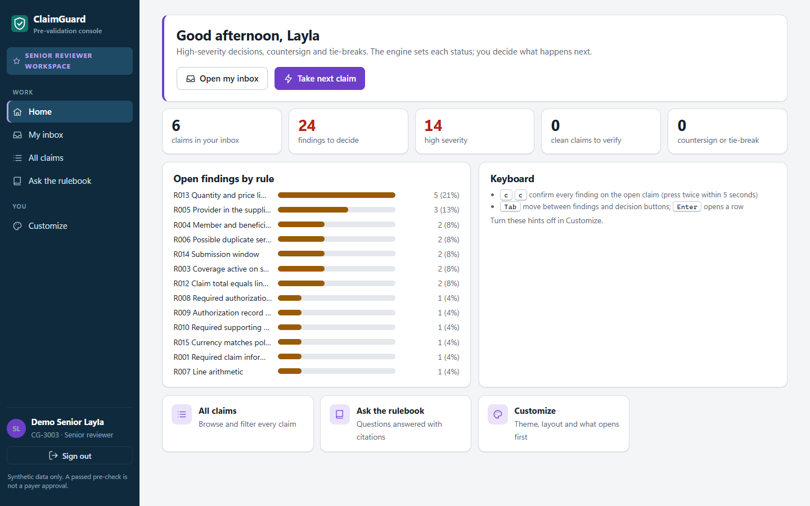 | 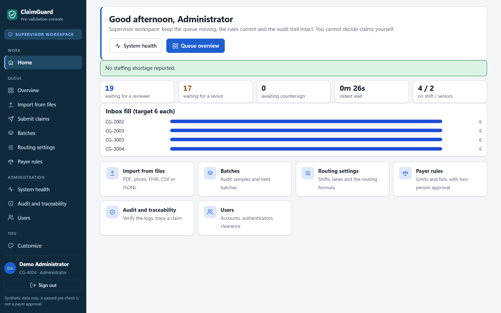 | 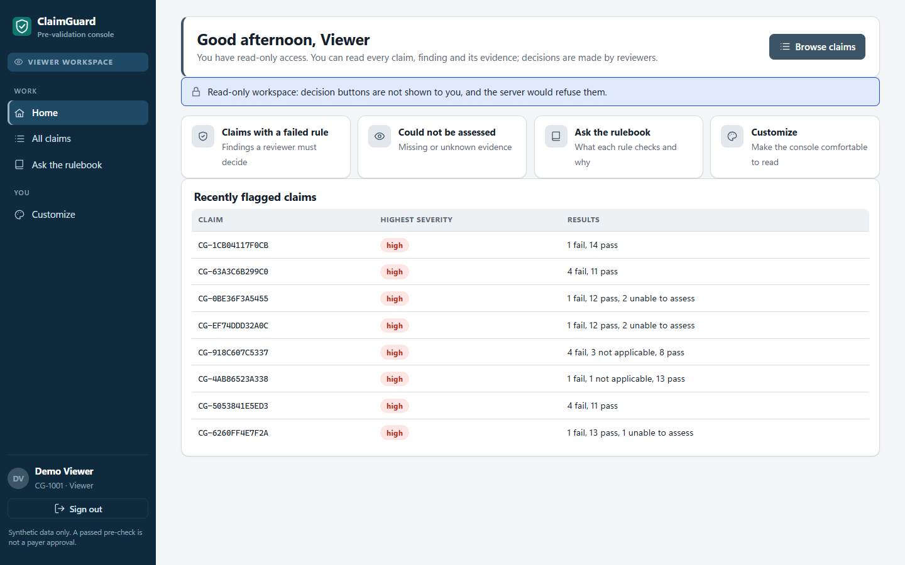 |

## 4. Customize: personal templates

*You → Customize* (`#/customize`) is open to everyone. Each change applies at once:

- **Appearance:** theme (system, light, dark), accent (6 colours), density (comfortable, compact), text size (S, M, L).
- **Claim page:** layout (side by side, stacked), open the evidence, show AI drafts, list passed rules, keyboard hints (reviewers and seniors only).
- **Start and navigation:** home page, the inbox view (by claim or by rule), and which menu items to show.
- **Share:** the setup exports as a small JSON template that can be copied to another PC or given to a colleague, imported back, or reset to the role's template. A live preview shows a sample finding drawn with the real classes.

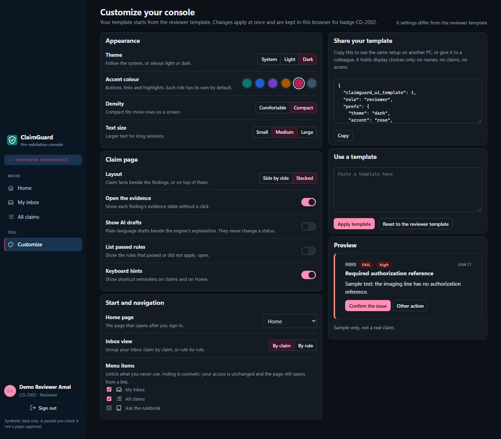

**How it is kept safe:**

- **Looks only, never access.** A template holds display choices only. Hiding a menu item is cosmetic (the page still opens from a link, and an item stays visible while it is the open page). A template cannot show a page that the permissions hide. Only *Home* and *Customize* are open to every signed-in person, and a test pins that.
- **Imports are filtered.** `CG.cleanPrefs` keeps only known keys with values from fixed lists. The home page and menu entries must match `#/word`. Anything else (unknown keys, `javascript:` addresses, markup, "isAdmin") is dropped. This is tested by running `lib.js` in Node against a hostile template.
- **No inline styles.** Every choice is a `data-*` attribute on `<html>` matched by the stylesheet, so the strict Content-Security-Policy (`style-src 'self'`) is unchanged and the markup-sink scan still passes.
- **Where it is stored.** Templates are kept per badge in this browser's `localStorage`. Every access is wrapped: in a private window the change lasts for the page. They hold no name, claim or secret.

## 5. Accessibility and phone

- **Keyboard and screen readers:** a *Skip to content* link; the page title follows the page; focus moves to the main area on navigation; labels are tied to their inputs on sign-in; the segmented controls and switches expose `aria-pressed` and `role=switch`.
- **Colour:** a status is always written as a word (chips, notices), never colour alone; the focus ring is visible.
- **Motion:** `prefers-reduced-motion` turns off transitions.
- **Phone:** under 860 px a top bar with a menu button opens the navigation as a drawer (Escape closes it). Under 640 px **every table becomes a stack of labelled cards**, built from `data-label` on each cell, so no page scrolls sideways.

| Inbox on a phone, before | After |
|---|---|
| 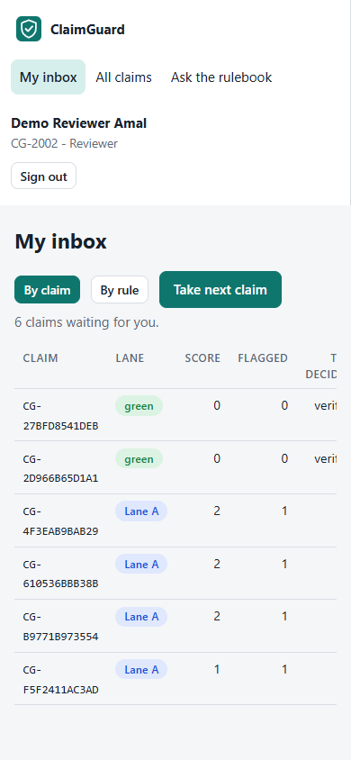 | 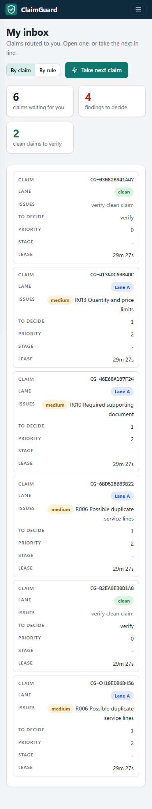 |

## 6. How it was checked (2026-10-25, Windows 11, Chrome headless through Playwright, against `python scripts/serve_access.py --demo`)

- **`tests/test_ui_console.py`: 14 tests passed at this stage** (17 after section 8), including 3 new ones: the hostile-template filter, a template for every role, and only Home and Customize open to every role. Every script passes `node --check`.
- **Screenshot run:** every role signed in through the demo logins; Home, inbox, a flagged claim, the claim list, Customize, the queue and health pages, at 1440 px and 390 px. There were no page errors. The only HTTP errors were 404s for `/work/events`, `/ledger` and `/approvals`, which exist only in the Rust server and are not UI faults.
- **Functional script, 24 of 24 checks pass:** a reviewer lands on Home with the teal template; choosing dark, rose, compact, stacked, hiding AI drafts and hiding a menu item each take effect and survive a reload; a claim opened afterwards has no AI box; an imported hostile template is filtered; reset restores the role template; on a phone the Home, inbox, claim and claim list fit without sideways scrolling and the menu opens.

## 7. Not done / limits

- **The Rust build was not recompiled.** The UI files are embedded at compile time; `claimstore.rs` lists the new `views-me.js`, but `cargo` was not available here. Rebuild `cg` and the desktop app before shipping, and rerun `rust/tools/console_review.py`.
- **Templates are per browser, not per account on the server.** Moving to another PC means exporting and importing the template. A supervisor cannot yet set the role templates for everyone, or push one template to a team: that needs a small server route and storage (two-person approval would fit the payer-rules pattern).
- **No usability test with real people** yet. The blueprint's acceptance check still needs running: three people each complete a review unaided, timed, using the script below. Also missing: a manual screen-reader pass (NVDA, VoiceOver), and a contrast measurement of each accent in both themes. The colours were chosen for contrast but not measured.
- The admin, import, payer-rules, audit and health pages got the new design through the shared stylesheet, but were not restructured.
- The stacked layout puts every fact card (including passed rules and history) above the findings. A finer split may suit some people better.

## 8. Second pass (2026-10-25): an interface per clearance level, and deeper customization

### 8.1 Each employee's level is visible everywhere

The demo server now has named employees, one or two per level. They are synthetic, as before:

| Badge | Name | Title | Level |
|---|---|---|---|
| CG-1001 | Nadia Haddad | Claims analyst (read-only) | L1 Viewer |
| CG-2002, CG-2003 | Amal Bennani, Omar Saidi | Claims officer | L2 Reviewer |
| CG-3003, CG-3004 | Layla Mansour, Karim Zaidi | Senior claims officer | L3 Senior reviewer |
| CG-4004 | Sami Khoury | Claims operations supervisor | L4 Supervisor |

On the local demo, the sign-in page lists them as **employee cards**, each with a level badge. One click signs that person in. This uses a new demo-only route, `GET /demo/people` (in `scripts/serve_access.py`), which returns badge, name, title and level, never a password or seed, and answers only requests from this PC. `GET /demo/login/{level}?badge=` picks a specific employee. Both are tested (`DemoStaff` in `tests/test_ui_console.py`). The Rust server (`cg serve --demo`, and so `ClaimGuard.exe`) has the same routes and the same names and titles (`rust/crates/cg-cli/src/serve.rs`, `rust/crates/cg-api/src/lib.rs`). The desktop window no longer exposes its own login bridge, so it shows the employee cards too.

Inside the console, the level is shown in a **colour fixed per level that no personal setting can change**: L1 slate, L2 teal, L3 violet, L4 blue. It appears in five places:

- the **level badge** (`L3 · Senior reviewer` and four pips) in the sidebar, the sign-in cards and the Home header;
- a **clearance bar** at the top of every page: *Read only* for viewers, *Can decide* for reviewers, *High-severity clearance* for seniors, *Cannot decide claims* for the supervisor, each with one line saying what the level does;
- a coloured band on top of the content, and the active menu item;
- **menu colours per level** (slate, deep teal, plum, navy);
- a **Your clearance** card on Home: the four levels as a ladder with the person's rung marked, then *You can* and *Not in your level*, read from the permissions the server reported.

| Sign-in | Senior (L3) | Viewer (L1) | Supervisor (L4) |
|---|---|---|---|
| 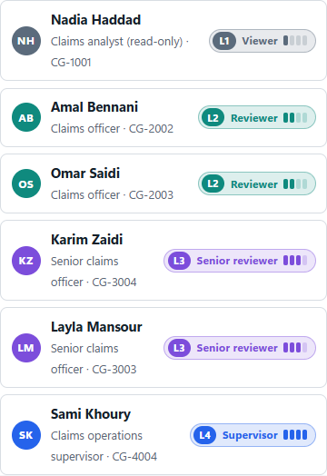 | 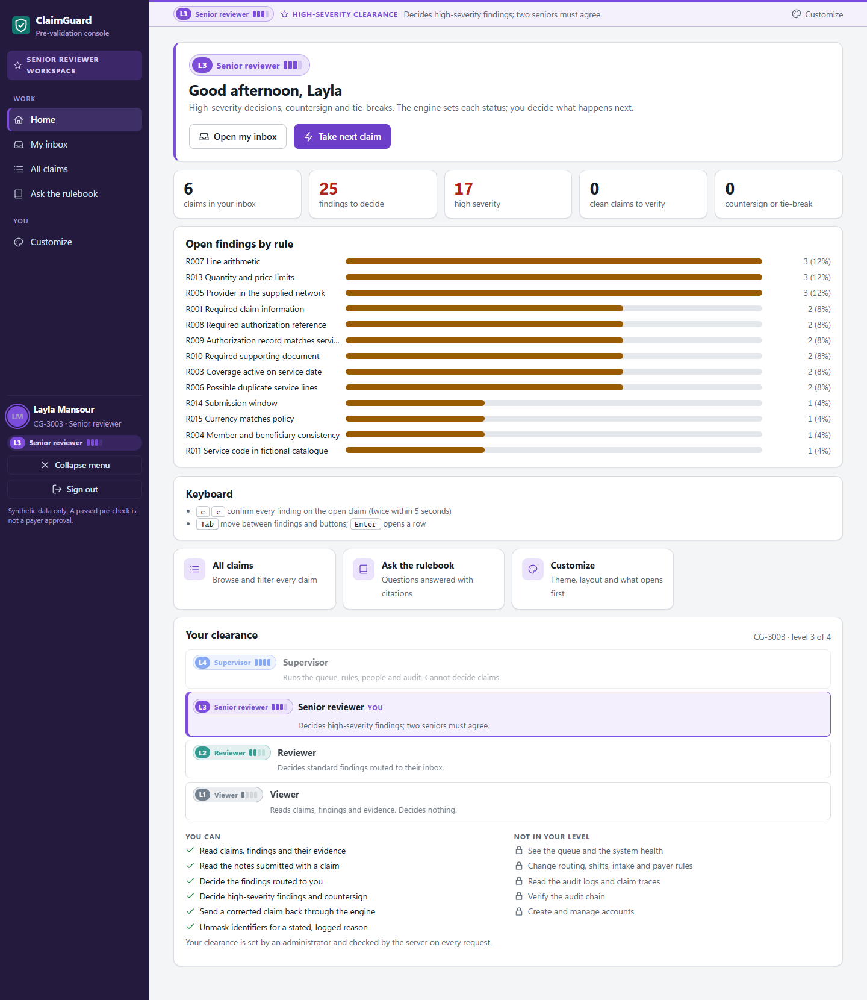 | 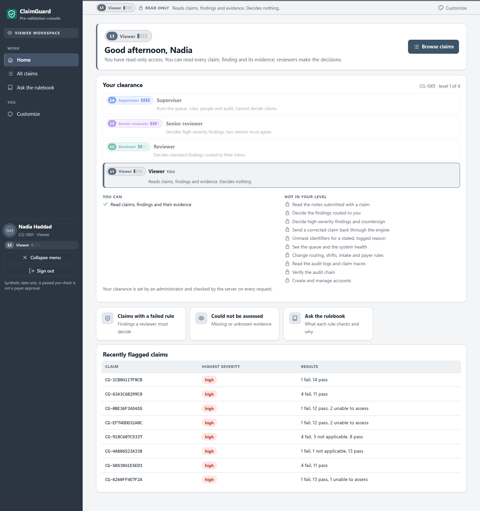 | 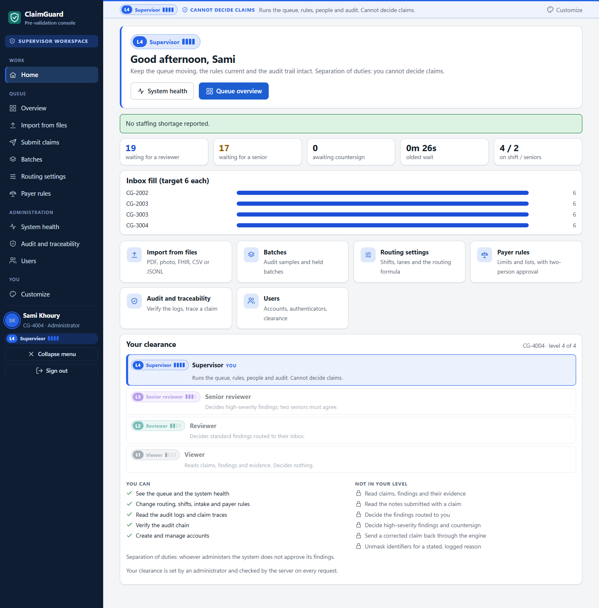 |

### 8.2 Deeper customization

Customize now has six tabs, a live preview with a miniature console, and over 30 settings:

| Tab | Settings |
|---|---|
| Look | theme; accent from 6 presets **or any colour** (picker or hex code; the text on it is chosen black or white by WCAG luminance); menu style (level colours, dark, light, accent-tinted); corners (square, rounded, round); typeface (system, humanist, serif, mono, from fonts on the PC only); text size S to XL; density; contrast (normal, high); animation (system, off) |
| Layout | home page; narrow icon-only menu (also a button in the sidebar); clearance bar on or off; greeting; which menu items show |
| Claim page | side by side or stacked; evidence open; AI drafts; the corrective-action box; passed rules; keyboard hints |
| Lists | striped rows; sticky headers; underlined links; inbox view; which inbox columns show |
| Home | switch each widget of the role's Home on or off and set its order |
| Profiles and sharing | 6 ready-made looks (Focus, Night shift, High contrast, Operator compact, Large and calm, Classic paper); up to 12 **named profiles** saved and switched in one click; export and import a template; reset |

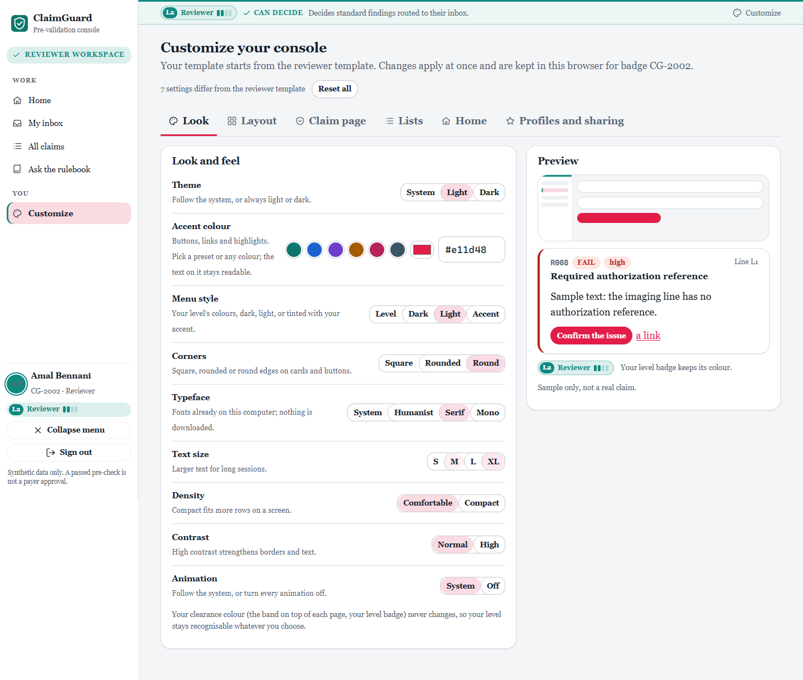

**The safety rules from section 4 still hold.** Every new value is in an allowed list:

- a custom colour must be `#` and six hex digits;
- widgets and columns must be known names;
- profile names lose control characters and `<` `>`, and are always shown as text;
- the custom accent is the only value written through the CSS object model, which the CSP allows (unlike inline style attributes); everything else is a `data-*` attribute on `<html>`.

The level colour is deliberately not customizable, so a screenshot or a colleague's screen always shows which clearance is acting.

### 8.3 Checked

- `tests/test_ui_console.py`: **17 pass** (3 new: deep settings filtered, readable text on any accent and clean profile names, the staff list holds no secret and answers only locally). `tests/test_desktop.py` and `tests/test_demo.py` still pass.
- **Role check, 35 of 35:**
  - The sign-in page lists 6 employees, and each card signs that person in.
  - For each level, `data-role`, the badge (`L1` to `L4`), the pips and the marked rung are right, and the four menu colours differ.
  - A viewer's claim page has no decision buttons.
  - On Customize: a custom accent applies with readable text and leaves the level colour unchanged; light menu, round corners, serif and XL apply; the narrow menu collapses to under 100 px.
  - On Home and the inbox: hiding the clearance widget, moving a widget and hiding the Priority column each take effect.
  - A profile saves with a cleaned name and restores its look; a ready-made look applies; *Reset all* restores the level template; no page errors.
- The first functional script (section 6) still passes 24 of 24, updated for the tabs.

### 8.4 Still open

- `/demo/people` is served by both demo servers (Python and Rust); `ClaimGuard.exe` is rebuilt with it.
- Profiles live in the browser, like templates.
- `color-mix()` is needed for the accent-tinted menu and the custom accent's shades: Chrome or Edge 111+ and WebView2 have it; older browsers fall back to the plain colours.
- The contrast of each level colour on each menu style has not been measured.

### Usability test script (for the planned check)

1. Sign in as a reviewer. Task: *"Decide every finding in your inbox; dismiss one with a reason."*
2. Measure time per claim, errors (a wrong action, a missing reason) and whether help was needed.
3. Ask: *"Which rule failed, on which line, and what did the engine see?"* It passes if answered from the screen alone.
4. Sign in as a viewer. Task: *"Find a claim that could not be assessed and say why."*
5. Ask each person to change one setting in Customize without being told where it is.

## 9. Third pass (2026-10-25): brand theme, backgrounds, profile pictures and notifications

**Brand theme.** The console now uses the logo palette (docs/brand): Cloud page, Midnight Circuit and Neural Indigo sidebar, Violet Ink accent (the new default "brand" accent), a Midnight hero on Home, and the violet-cyan-mint gradient on tiles, page titles and AI boxes. Level colours moved onto the palette and stay fixed.

**Background (Customize → Background).** Nine CSS templates (Plain, Aurora, Neural grid, Dots, Constellation, Dusk, Ocean, Forest, Paper) or the person's own photo. A "veil" setting (light, medium, strong) keeps titles readable, and "Glass cards" lets a blurred hint of the background through the cards. The photo is shrunk in the browser (longest side 1920 px, JPEG) and kept in `localStorage` per badge. It is never sent to the server and never included in an exported template. It reaches the page as a checked `data:image/...;base64` URL through `style.setProperty` (`CG.photoOk`), so the strict CSP still holds.

**Profile picture.** Click the small round avatar in the sidebar (camera badge), or use Customize → Profile picture. The picture is cropped to a 256 px square and replaces the initials in the sidebar and on that person's employee card on the demo sign-in page. The level-colour ring stays. It is stored per badge in this browser only, so colleagues on other computers still see initials. Server-side storage would be the next step.

**Notifications (bell in the clearance bar, the mobile top bar, or the menu when the bar is hidden).** The bell polls every 7 s:
- New claims entering intake. In the demo this comes from `GET /demo/feed`, a log kept by `workqueue.demo.ArrivalFeed` that counts claims from the simulator, the Submit page and imports. Outside the demo, supervisors get the same signal from the `/queue/dashboard` counts.
- Claims newly routed to the person's own inbox (`/work/inbox`), for reviewers and seniors.

Each alert adds an item to the panel (30 kept per badge), shows a toast, puts the unread count in the tab title, and plays a sound made with the Web Audio API. Sounds: **Guard chime** (ClaimGuard's own: three rising notes, like the logo's three nodes), Soft ping, Double tap, Synth pulse, or Silent, with three volume levels. Desktop notifications are optional and only show when the tab is in the background.

**Demo simulator.** "Simulate new claims (demo)" in the panel or the Notifications tab calls `POST /demo/arrivals?n=1..5`, which sends the next sample claims (the 340 not loaded at start) through the real intake. Like the other demo routes, it answers only from this PC. It also requires the `X-CG-Demo: 1` header, which another site's form cannot send.

**Limits.** Pictures, backgrounds and alert history live in the browser (per badge, per computer). `/demo/feed` and `/demo/arrivals` exist in both demo servers; in the Rust build the log is `cg_api::demo::ArrivalFeed`, told about each newly stored claim by the intake's `on_stored` hook, and `ClaimGuard.exe` is rebuilt with the new UI. The sounds could not be listened to in the automated check (headless browser); they were only checked to run without errors.

## 10. Fourth pass (2026-10-25): the administration template

The console now follows the ClaimGuard administration template. Identity: a navy shield holding a claim document with a check, a "Claims administration" line, and a navy-and-white palette (docs/brand v2).

- **Sidebar:** navy `#15294C` with the white mark, "ClaimGuard" and "CLAIMS ADMINISTRATION" in spaced capitals, and a text-only menu with a Steel Blue pill on the open page. Icons come back in the narrow menu.
- **Pages:** light grey page, white cards with thin borders, large navy titles, tables with uppercase letter-spaced headers, and navy primary buttons.
- **Sign-in:** a single centred card (mark, name, line, Badge number, Password, Authenticator code, navy Sign in), with the demo staff cards below it.
- **Tab title:** "Page — ClaimGuard Administration".
- **Kept:** clearance levels and their colours, the identity bar, Customize (every option, with navy as the default "Brand" accent), backgrounds, profile pictures, notifications and the Brand page (rewritten for v2).
- **Removed from the interface:** the violet-cyan gradient, the "AI" tag and the old two-panel sign-in.

Dark mode keeps the same layout in deep navy (`#0B1220` page, `#121B2D` cards, `#9DB7FF` accent). IBM Plex Sans is used when it is installed. It cannot be downloaded, because the CSP blocks font files, so Segoe UI is the usual fallback. `ClaimGuard.exe` needs a Rust rebuild to include `icon-light.svg` and the new styles.

## 11. Fifth pass (2026-10-28): item focus

Claims, findings and rules are drawn as distinct objects so the eye lands on them first, not on the page around them. Customize → Look → **Item focus**: *Normal* (the earlier look), *Strong* (default) and *Spotlight*.

- **Findings:** raised cards with a 7 px severity edge, a tinted header band (red, amber or green), a solid rule tag (`R013`), a larger title, the affected line as a pill, a lift on hover and an accent ring while you work in one. Settled findings fade back.
- **Claims:** every claim number in a list is a tag; the row under the pointer gets an accent edge and the tag turns solid. On a claim page the number is a large tag and the total is the biggest figure in the facts card. Lines named by an open finding are shaded more strongly.
- **Rules:** rule codes are tags everywhere (inbox Issues column, the By rule groups, the payer-rule cards); severity and FAIL chips are solid.
- **Counts:** Home and inbox tiles get a coloured top edge and larger numbers.
- **Spotlight:** while one finding or one list row is hovered or being worked on, the others dim.

All of it is CSS keyed on `html[data-focus]` plus the `cid`, `rid`, `rulecard` and `policycard` classes; dark mode, phone layout, high contrast and reduced motion keep working.

Page vs items (same pass): with Strong or Spotlight, the page behind the content is a darker grey-blue (`#DBE2EC`; dark mode `#050A14`) and every card, tile and panel is white (dark `#17223A`) with a firmer border and a shadow, so the inbox, claims and panels no longer blend into the background. Normal keeps the earlier flat look.

## 12. Patient history on a claim (2026-10-28)

On a claim in their inbox, the reviewer presses **Show this patient's other claims** (card under the service lines). It lists the patient's other claims, newest first: claim number, date, provider, total, state, and the rules that flagged each one, with a summary line (how many, how many flagged, the latest date). A row opens that claim. It stays a button, not a default; only the person holding the claim can ask, each look is written to the security log (`patient_history_viewed`), and no patient identifier, note or line detail is returned.

- The Python server now has `GET /api/v1/work/claims/{id}/history` (`QueueService.patient_history`), the same as the Rust server.
- The demo sample has one claim per patient, so the demo gives every third loaded claim's patient two or three earlier synthetic visits (`demo.seed_returning_patients`, from the last 60 sample claims, which "Simulate new claims" no longer uses). Those visits go through the real intake, so they are triaged and can also appear in inboxes.

## 13. Accessibility (2026-10-29)

Customize → **Accessibility** (second tab), kept per badge like every other setting.

- **One-click starting points:** red-green colour blindness, blue-yellow colour blindness, no colour (greyscale), dyslexia-friendly reading, low vision, fewer distractions. Each one only sets ordinary settings, which can be changed one by one afterwards; **Clear accessibility settings** puts them back to the person's template.
- **Colour vision:** status colours for red-green (orange, olive, blue), blue-yellow (red, magenta, teal) or greyscale, in light and dark mode; every text colour keeps WCAG AA contrast (4.9:1 or more on cards and page). **Shapes on statuses** (always on with a colour-vision mode) adds ▲ high, ◆ medium, ✕ fail, ? unable to assess, ✓ pass, and solid, dashed or dotted edges on findings, tiles and highlighted lines, so colour is never the only signal. Shapes are hidden from screen readers, which already read the word.
- **Reading:** "Easy to read" typeface (OpenDyslexic, Lexend or Atkinson Hyperlegible when installed, otherwise Verdana; nothing is downloaded), text size, text spacing (Wide = WCAG 1.4.12 values), and a reading ruler that follows the pointer.
- **Seeing and moving around:** high contrast, a strong two-colour focus ring, underlined links, animation off.
