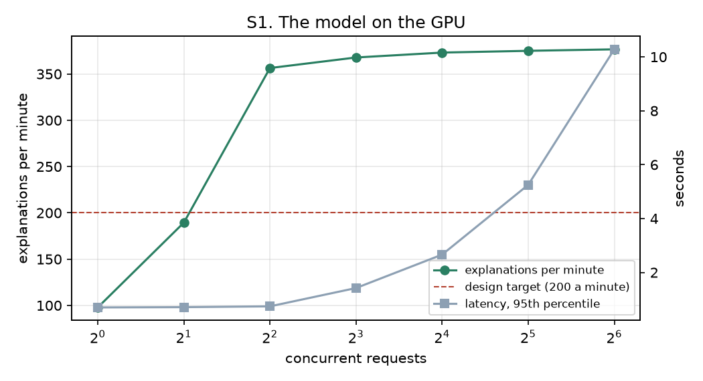
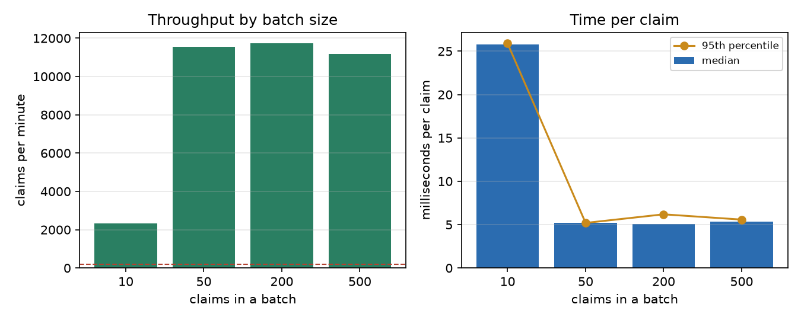
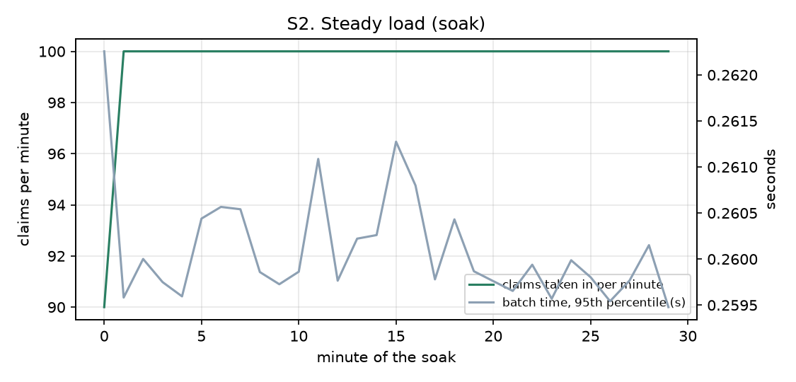
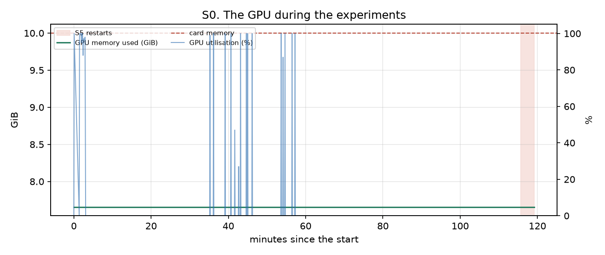
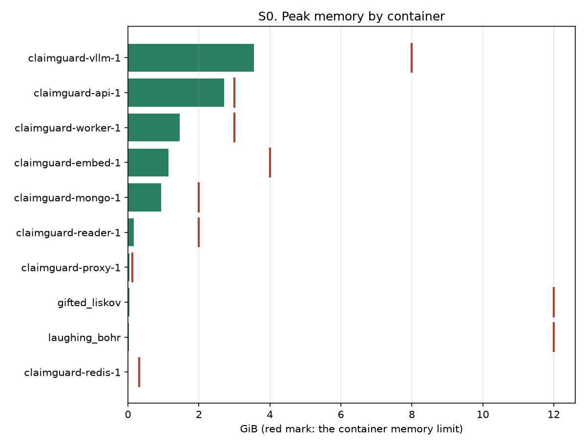
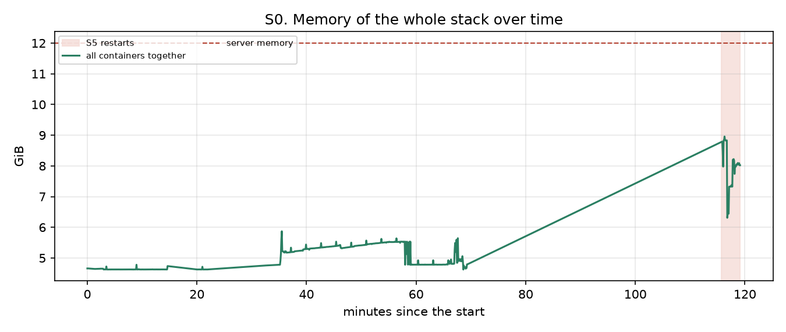
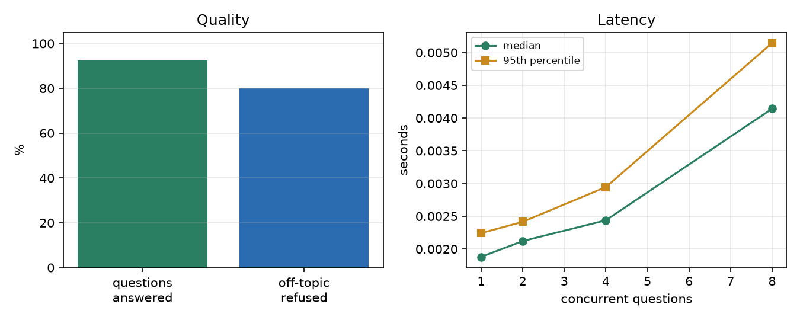
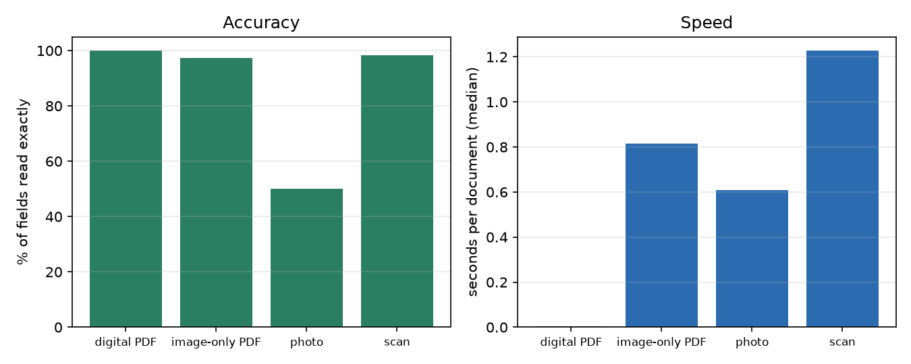
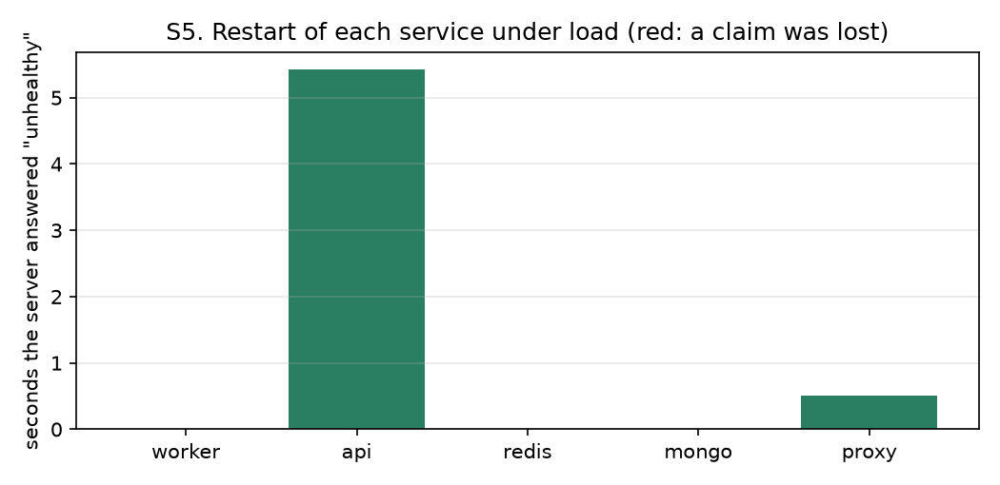

# 66. Server experiment results: run `server_20261031`

Produced by `experiments/server/` (plan, targets and method: [docs/65](65_Server_Experiment_Plan.md)). Every number below was computed from the files in `outputs/server/server_20261031/`.

## 1. The machine

| Item | Value |
|---|---|
| Host | khalil |
| Operating system | Linux-7.0.14-17-pve-x86_64-with-glibc2.43 |
| CPU | AMD Ryzen 7 5700X 8-Core Processor (8 threads) |
| Memory | 12.0 GiB |
| GPU | NVIDIA GeForce RTX 3080, 10240 MiB, 615.71.09 |
| Docker | Docker version 29.9.2, build a82e528 |
| Compose | 5.6.1 |
| Code version | not available |
| Run started | 2026-10-31T13:56:46Z |

## 2. Scoreboard

| Experiment | Measure | Target | Result | Verdict |
|---|---|---|---|---|
| S1 | Explanations per minute (best level) | >= 200 | 376.6 at 64 concurrent | PASS |
| S1 | Model requests that failed | 0 | 0 | PASS |
| S2 | Claims per minute through the whole pipeline (best stage) | >= 200 | 11721.3 | PASS |
| S2 | Batches that failed | 0 | 1 | FAIL |
| S2 | Slowest read request right after the load (95th percentile) | < 2 s | 1.22 s | FAIL |
| S3 | Rulebook questions answered with the right rule | >= 90 % | 92 % | PASS |
| S3 | Off-topic strings refused | all | 4 of 5 | FAIL |
| S4 | Fields read exactly from documents | >= 95 % | 86.4 % | FAIL |
| S4 | Documents that could not be read | 0 | 0 | PASS |
| S5 | Acknowledged claims lost in restarts | 0 | 0 | PASS |
| S5 | Services back after restart | all | 5 of 5 | PASS |
| S6 | internal ports closed | yes | no | FAIL |
| S6 | https open | yes | yes | PASS |
| S6 | http redirects to https | yes | yes | PASS |
| S6 | old tls refused | yes | yes | PASS |
| S6 | security headers present | yes | yes | PASS |
| S6 | anonymous api refused | yes | yes | PASS |
| S6 | anonymous health panel refused | yes | yes | PASS |
| S6 | healthz is minimal | yes | yes | PASS |
| S7 | health not down | yes | yes | PASS |
| S7 | no failing probe | yes | no | FAIL |
| S7 | audit chains verify | yes | yes | PASS |
| S7 | ledger verifies | yes | yes | PASS |
| S0 | Peak memory of all containers vs server memory | <= 85 % | 75 % of 12.0 GiB | PASS |
| S0 | Peak GPU memory vs the card | <= 95 % | 77 % of 10 GiB | PASS |
| S0 | Containers that reached their memory limit | none | none | PASS |

20 of 26 measures pass; 6 fail.

## 3. S1. The explanation model on the GPU

Model `google/gemma-3-4b-it`, one explanation per request (about 250 tokens in, up to 160 out, temperature 0).

| Concurrent | Requests | Errors | Per minute | Latency p50 (s) | Latency p95 (s) | Tokens/s |
|---|---|---|---|---|---|---|
| 1 | 16 | 0 | 97.8 | 0.62 | 0.7 | 120.3 |
| 2 | 16 | 0 | 189.4 | 0.63 | 0.71 | 233.2 |
| 4 | 16 | 0 | 356.4 | 0.64 | 0.74 | 429.5 |
| 8 | 32 | 0 | 367.8 | 1.25 | 1.42 | 452.7 |
| 16 | 64 | 0 | 373.1 | 2.5 | 2.66 | 455.0 |
| 32 | 128 | 0 | 375.0 | 5.04 | 5.25 | 459.1 |
| 64 | 256 | 0 | 376.6 | 10.11 | 10.28 | 459.5 |

Best: **376.6 a minute** at 64 concurrent requests; GPU memory peak during the benchmark: not measured (no GPU reading).

## 4. S2. The claim pipeline

Claims go through the proxy, the API, the queue, the engine and the store (POST /api/v1/queue/submit, asynchronous), in batches of rising size.

| Batch | Batches | Claims in | Errors | Claims/min | Accept p50 (s) | Batch done p50 (s) | Batch done p95 (s) | ms per claim p50 |
|---|---|---|---|---|---|---|---|---|
| 10 | 6 | 60 | 0 | 2323.9 | 0.00 | 0.26 | 0.26 | 26 |
| 50 | 6 | 300 | 0 | 11549.9 | 0.00 | 0.26 | 0.26 | 5 |
| 200 | 4 | 800 | 0 | 11721.3 | 0.00 | 1.02 | 1.24 | 5 |
| 500 | 2 | 1000 | 0 | 11181.9 | 0.01 | 2.68 | 2.79 | 5 |

Answer time of three read requests (seconds), idle before the load and right after it:

| Request | Before p50 | Before p95 | After p50 | After p95 |
|---|---|---|---|---|
| dashboard | 0.003 | 0.003 | 0.706 | 0.881 |
| claims_list | 0.002 | 0.002 | 0.002 | 0.003 |
| health_panel | 0.004 | 0.005 | 0.972 | 1.224 (8 refused) |

Steady load (soak):

30 minute(s), 2990 claims, 1 failed batches.

## 5. S0. Resources during the run

641 samples over 119 minutes (container memory and CPU from `docker stats`, GPU from `nvidia-smi`).

| Container | Peak memory (MiB) | Limit (MiB) | Share of limit |
|---|---|---|---|
| claimguard-vllm-1 | 3631 | 8192 | 44 % |
| claimguard-api-1 | 2771 | 3072 | 90 % |
| claimguard-worker-1 | 1495 | 3072 | 49 % |
| claimguard-embed-1 | 1166 | 4096 | 28 % |
| claimguard-mongo-1 | 951 | 2048 | 46 % |
| claimguard-reader-1 | 167 | 2048 | 8 % |
| claimguard-proxy-1 | 37 | 128 | 29 % |
| gifted_liskov | 34 | 12288 | 0 % |
| laughing_bohr | 26 | 12288 | 0 % |
| claimguard-redis-1 | 7 | 320 | 2 % |

GPU peaks: memory 7839 of 10240 MiB, utilisation 100 %, temperature 68 C, power 336 W.

The server never had less than 3.1 GiB of 12.0 GiB available.

## 6. S3. Ask the rulebook, by meaning

24 of 26 questions returned the right rule (92 %); 4 of 5 off-topic strings were refused. Rate-limited answers (429): 0. HTTP statuses of the quality pass: {"200": 26}.

| Concurrent | Questions | Answered | Per second | Latency p50 (s) | Latency p95 (s) |
|---|---|---|---|---|---|
| 1 | 78 | 78 | 515.6 | 0.002 | 0.002 |
| 2 | 78 | 78 | 909.1 | 0.002 | 0.002 |
| 4 | 78 | 78 | 1567.4 | 0.002 | 0.003 |
| 8 | 78 | 78 | 1819.3 | 0.004 | 0.005 |

Questions that missed: "claim line without a service date" (wanted rule R001); "how many days after the service can a claim be submitted" (wanted rule R014, policy EDU-BASIC (table version 0), policy EDU-PLUS (table version 0)).

## 7. S4. Documents to claims

40 documents tried, 0 failed, 0 waits because the reader was busy.

| Condition | Documents | Field accuracy | Documents fully right | Seconds p50 | Seconds p95 |
|---|---|---|---|---|---|
| digital PDF | 10 | 100.0 % | 100 % | 0.0 | 0.0 |
| image-only PDF | 10 | 97.3 % | 70 % | 0.8 | 0.8 |
| photo | 10 | 50.0 % | 20 % | 0.6 | 0.7 |
| scan | 10 | 98.2 % | 80 % | 1.2 | 1.3 |

For comparison: docs/45: 97.4 % of fields, 66.7 % of documents fully right, two readers, on the build PC.

## 8. S5. Restarts under load

| Service | Restart command (s) | Unhealthy (s) | Recovered | Sent | Acknowledged | Failed during restart | Acknowledged but missing |
|---|---|---|---|---|---|---|---|
| worker | 4.3 | 0.0 | yes | 430 | 430 | 0 | 0 |
| api | 5.6 | 5.4 | yes | 320 | 300 | 20 | 0 |
| redis | 0.3 | 0.0 | yes | 380 | 380 | 0 | 0 |
| mongo | 0.5 | 0.0 | yes | 360 | 360 | 0 | 0 |
| proxy | 0.4 | 0.5 | yes | 205 | 195 | 10 | 0 |

## 9. S6. Exposure seen from the network

| Port | Service | Open |
|---|---|---|
| 22 | SSH | no |
| 80 | HTTP (redirect only) | yes |
| 443 | HTTPS | yes |
| 3000 | app | no |
| 5432 | database | no |
| 6379 | Redis | no |
| 8000 | model server | no |
| 8080 | API | yes |
| 8091 | embedding service | no |
| 8095 | document reader | no |
| 11434 | model server (Ollama) | no |
| 27017 | MongoDB | no |

TLS: older protocols {"TLS1.0": "refused", "TLS1.1": "refused"}, negotiated TLSv1.3, certificate kernelsi.com issued by US Google Trust Services WE1, 83 days left. Headers: {"strict-transport-security": true, "x-content-type-options": true, "content-security-policy": true, "framing_protected": true, "no_server_version": true}.

## 10. S7. Integrity and backup

Health panel: degraded (0.01 s). Audit verification: HTTP 200. Ledger: HTTP 200.

| Health probe | Status |
|---|---|
| api | ok |
| user_store | ok |
| audit_logs | ok |
| disk | ok |
| anchor | ok |
| timestamp | unknown |
| ledger | ok |
| signals | degraded |
| queue_store | ok |
| broker | ok |
| scheduler | ok |
| audit_guard | ok |
| outbox | ok |
| flow | ok |
| model | ok |

## 11. How to read this

A FAIL is a finding, not an error in the scripts: write what was changed (a setting, a model, a limit) and run the failing experiment again, keeping both runs. Targets and their reasons are in docs/65 section 2. Everything here used synthetic claims; real hospital paper, handwriting and Arabic documents are still untested.

## 12. Review notes (added after the run)

The 16-page report `docs/reports/ClaimGuard_Server_Report.pdf` explains the run. What the scoreboard above does not say:

* **S6, "internal ports closed" = no (port 8080):** the scan went through Cloudflare, which answers on 8080 itself. On the server `ss -tlnp` shows only Caddy on 80 and 443. The scan therefore tested Cloudflare's edge; the server's own exposure (firewall, direct access by its address, encryption between Cloudflare and Caddy) is checked separately: docs/47, "Behind Cloudflare".
* **S7, "no failing probe" = no:** the `signals` probe counts failed sign-ins and the test accounts produced several; it clears after about an hour. `timestamp` is "unknown" because no timestamp authority (`TSA_URL`) is set.
* **S4, photos 50 %:** only Tesseract ran. The vision model (`baidu/Unlimited-OCR`, 88.1 % on photos on the build PC) was not part of the install, which only adds it when `CG_VLM_MODEL` is given. It does not fit on the 10 GB card beside the explanation model: docs/47, "The vision model".
* **S0, API memory 90 % of its limit:** the API keeps claims in memory; it was killed at the old 768 MB limit with about 7,000 queued claims and reached 2.77 GiB with about 8,500. The limit is now 3 GB as a stopgap. Reading the code did not confirm that the API holds the claims in memory (they are in MongoDB). It did find work that grows with the audit logs: checking a chain, the security-signals probe, the signed ledger and the payer-rules refresh each read a whole log file into memory, with a decrypted copy of every row, and the anchor check read the file twice; the health panel runs them. They now read one line at a time (`cg_audit::for_each_row`), so their memory no longer depends on the size of the log. Whether this was the main cause is not yet shown: the sizes of the audit logs on the server and a new memory measurement decide it.
* **S0, GPU 77 %:** vLLM reserves 85 % of the card (the value that worked; 0.55 did not start), so the 77 % is not free room.
* **S0, sampling:** the memory timeline has no samples between about minute 70 and 115, so the memory-growth criterion (under 100 MiB an hour) is not verified by this run.
* **S5, "0 lost":** counted as the queue total before and after, not claim by claim; a loss could be hidden by a claim that was refused to the client yet stored. The old read-back could not see queued claims at all (see the correction in `s05_resilience.py`).
* **Raw files:** `outputs/` is not committed by design (`.gitignore`); the figures and this chapter are the record. The first `report.md` in the run folder was an early partial and was removed.

## Found after go-live (1 November 2026)
* **Buttons answered "Request failed (unsupported_media_type)".** Every console button that posts without a form (sign out, claim, release, and others) failed behind Cloudflare and Caddy, for every role. The proxy forwards such a request as `Transfer-Encoding: chunked` with nothing in it; the API counted the header as "a body" and then refused it for having no JSON content type. Reproduced against the live site with `curl -X POST /api/v1/auth/logout` (415). Fixed in the API: only a real body counts (`cg-api` `guarded`), with a regression test. Why the experiments missed it: they always send a JSON body, and the build PC had no proxy in front.
* **"Ask the rulebook" gave no sign of work.** The page now shows a spinner at once, disables the button, and after 4 seconds says it is still working.
* **The Brand page was open to reviewers.** It is the identity sheet for the people who run the system; menu entry and route now need the administrator permission (`users.manage`).
* **S3 speed measured the answer cache.** The speed table above asks the same 26 questions three times and the server answers a repeated question from its cache, so 2 ms is not the cost of a new question. Measured from outside on the live site (one person, 31 different questions): median 4.6 s, slowest 6.1 s, none of them model-written, so the cause is on the server before any answer is written (embedding on 2 CPU cores, a rewrite step or the API; not yet known). `s03_search.py` now asks new questions (time stamp added), also runs the repeat for contrast, and saves each answer's `cached`, `tier`, `planner` and `timing` fields; the report prints them. The figures above stay as measured and are marked here as repeat-question figures.
