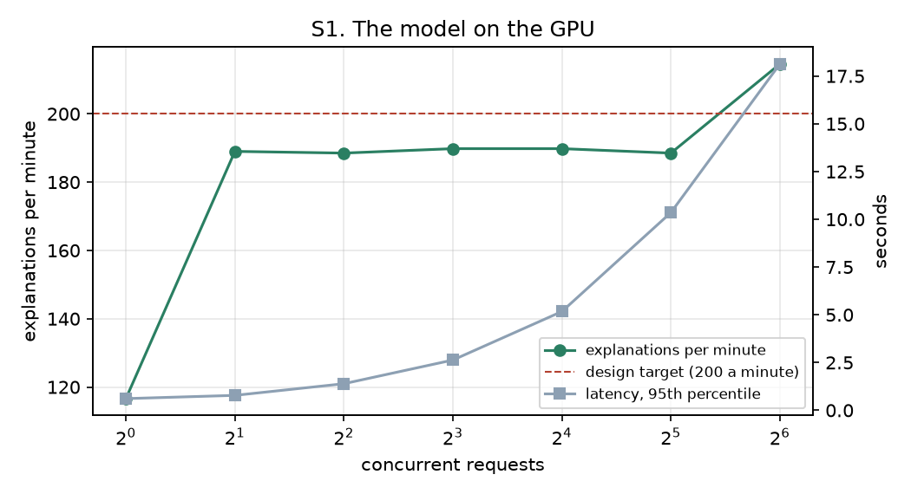
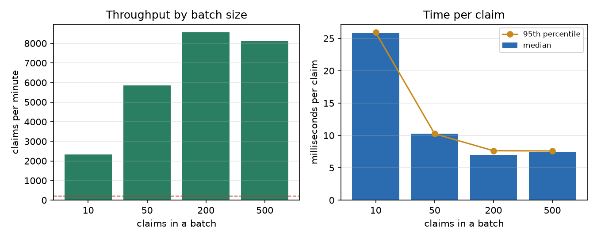
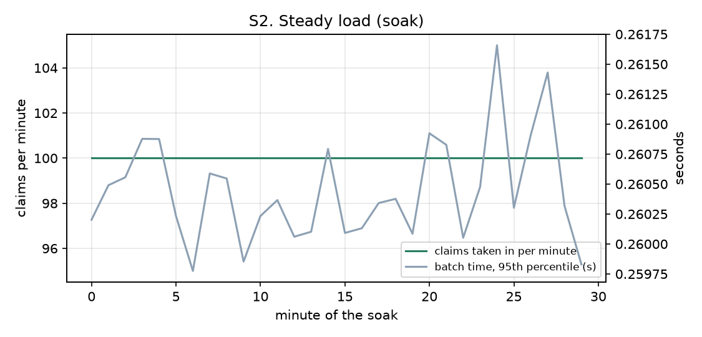
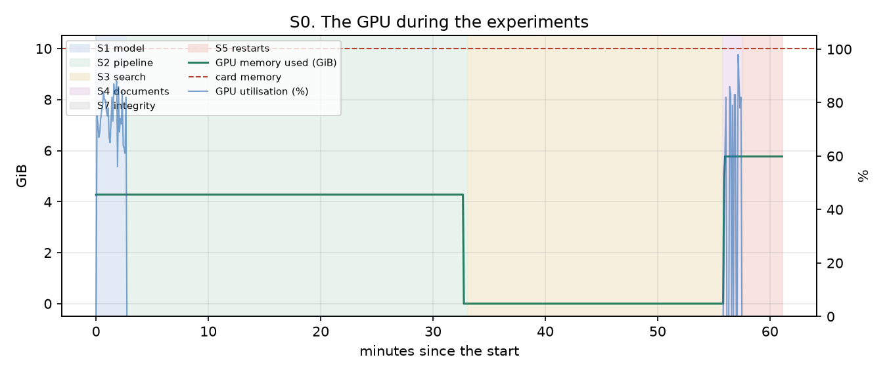
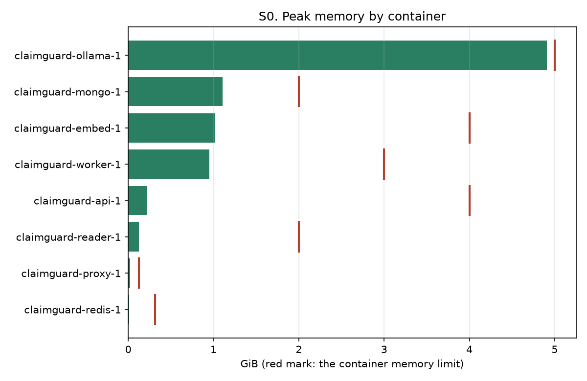
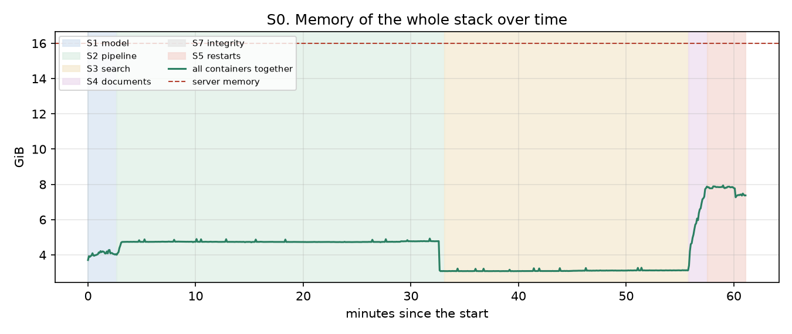
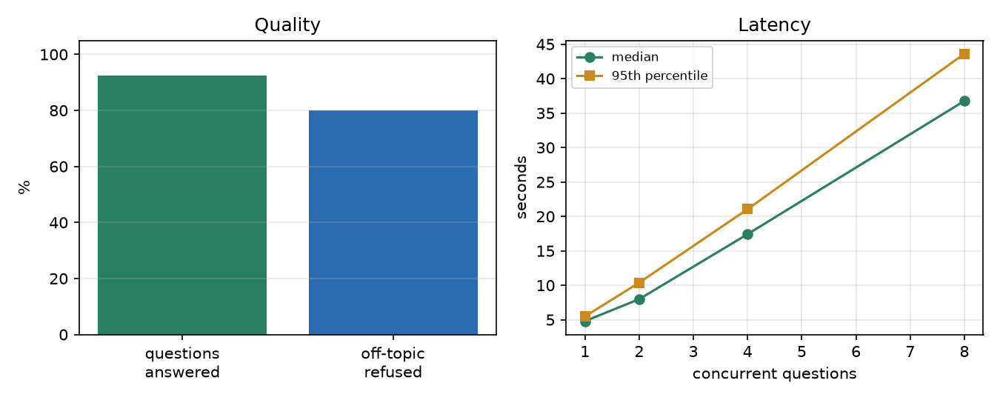
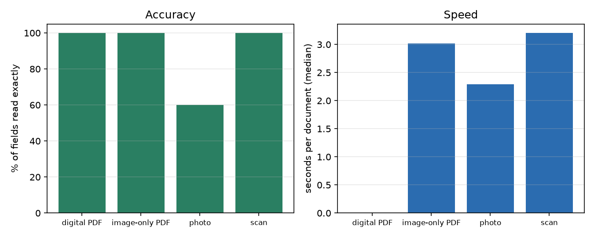
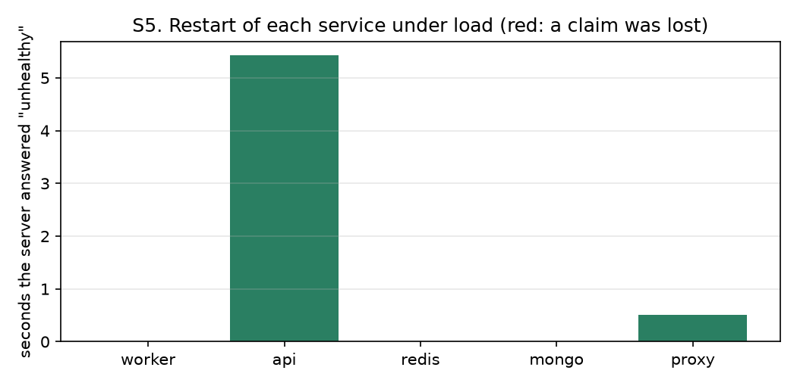

# 66. Server experiment results: run `server_20261101m`

Produced by `experiments/server/` (plan, targets and method: [docs/65](65_Server_Experiment_Plan.md)). Every number below was computed from the files in `outputs/server/server_20261101m/`.

## 1. The machine

| Item | Value |
|---|---|
| Host | khalil |
| Operating system | Linux-7.0.14-17-pve-x86_64-with-glibc2.43 |
| CPU | AMD Ryzen 7 5700X 8-Core Processor (8 threads) |
| Memory | 16.0 GiB |
| GPU | NVIDIA GeForce RTX 3080, 10240 MiB, 615.71.09 |
| Docker | Docker version 29.9.2, build a82e528 |
| Compose | 5.6.1 |
| Code version | not available |
| Run started | 2026-11-01T22:42:38Z |

## 2. Scoreboard

| Experiment | Measure | Target | Result | Verdict |
|---|---|---|---|---|
| S1 | Explanations per minute (best level) | >= 200 | 214.6 at 64 concurrent | PASS |
| S1 | Model requests that failed | 0 | 0 | PASS |
| S2 | Claims per minute through the whole pipeline (best stage) | >= 200 | 8551.3 | PASS |
| S2 | Batches that failed | 0 | 0 | PASS |
| S2 | Slowest read request right after the load (95th percentile) | < 2 s | 0.36 s | PASS |
| S3 | Rulebook questions answered with the right rule | >= 90 % | 92 % | PASS |
| S3 | Off-topic strings refused | all | 4 of 5 | FAIL |
| S4 | Fields read exactly from documents | >= 95 % | 90.0 % | FAIL |
| S4 | Documents that could not be read | 0 | 0 | PASS |
| S5 | Acknowledged claims lost in restarts | 0 | 0 | PASS |
| S5 | Services back after restart | all | 5 of 5 | PASS |
| S7 | health not down | yes | yes | PASS |
| S7 | no failing probe | yes | no | FAIL |
| S7 | audit chains verify | yes | yes | PASS |
| S7 | ledger verifies | yes | yes | PASS |
| S0 | Peak memory of all containers vs server memory | <= 85 % | 50 % of 16.0 GiB | PASS |
| S0 | Peak GPU memory vs the card | <= 95 % | 58 % of 10 GiB | PASS |
| S0 | Containers that reached their memory limit | none | claimguard-ollama-1 | FAIL |
| S0 | Memory growth during the pipeline experiment | < 100 MiB/hour | -241 MiB/h | PASS |

15 of 19 measures pass; 4 fail.

Not run in this session: s06 (run it from another machine).

## 3. S1. The explanation model on the GPU

Model `gemma3:4b`, one explanation per request (about 250 tokens in, up to 160 out, temperature 0).

| Concurrent | Requests | Errors | Per minute | Latency p50 (s) | Latency p95 (s) | Tokens/s |
|---|---|---|---|---|---|---|
| 1 | 16 | 0 | 116.6 | 0.51 | 0.61 | 139.5 |
| 2 | 16 | 0 | 189.0 | 0.63 | 0.78 | 228.0 |
| 4 | 16 | 0 | 188.5 | 1.23 | 1.39 | 227.3 |
| 8 | 32 | 0 | 189.8 | 2.5 | 2.63 | 229.8 |
| 16 | 64 | 0 | 189.8 | 5.02 | 5.17 | 229.0 |
| 32 | 128 | 0 | 188.5 | 10.16 | 10.35 | 229.2 |
| 64 | 256 | 0 | 214.6 | 17.68 | 18.13 | 263.4 |

Best: **214.6 a minute** at 64 concurrent requests; GPU memory peak during the benchmark: 4379 MiB.

## 4. S2. The claim pipeline

Claims go through the proxy, the API, the queue, the engine and the store (POST /api/v1/queue/submit, asynchronous), in batches of rising size.

| Batch | Batches | Claims in | Errors | Claims/min | Accept p50 (s) | Batch done p50 (s) | Batch done p95 (s) | ms per claim p50 |
|---|---|---|---|---|---|---|---|---|
| 10 | 6 | 60 | 0 | 2321.8 | 0.00 | 0.26 | 0.26 | 26 |
| 50 | 6 | 300 | 0 | 5847.9 | 0.00 | 0.51 | 0.51 | 10 |
| 200 | 4 | 800 | 0 | 8551.3 | 0.00 | 1.40 | 1.53 | 7 |
| 500 | 2 | 1000 | 0 | 8122.3 | 0.01 | 3.69 | 3.80 | 7 |

Answer time of three read requests (seconds), idle before the load and right after it:

| Request | Before p50 | Before p95 | After p50 | After p95 |
|---|---|---|---|---|
| dashboard | 0.030 | 0.032 | 0.196 | 0.219 |
| claims_list | 0.002 | 0.002 | 0.002 | 0.002 |
| health_panel | 0.154 | 0.377 | 0.338 | 0.362 |

Steady load (soak):

30 minute(s), 3000 claims, 0 failed batches.

## 5. S0. Resources during the run

734 samples over 61 minutes (container memory and CPU from `docker stats`, GPU from `nvidia-smi`).

| Container | Peak memory (MiB) | Limit (MiB) | Share of limit |
|---|---|---|---|
| claimguard-ollama-1 | 5029 | 5120 | 98 % |
| claimguard-mongo-1 | 1130 | 2048 | 55 % |
| claimguard-embed-1 | 1044 | 4096 | 25 % |
| claimguard-worker-1 | 973 | 3072 | 32 % |
| claimguard-api-1 | 230 | 4096 | 6 % |
| claimguard-reader-1 | 129 | 2048 | 6 % |
| claimguard-proxy-1 | 24 | 128 | 18 % |
| claimguard-redis-1 | 8 | 320 | 3 % |

GPU peaks: memory 5909 of 10240 MiB, utilisation 98 %, temperature 68 C, power 328 W.

The server never had less than 7.7 GiB of 16.0 GiB available.

Memory trend of the whole stack during S2: -241 MiB per hour (a straight-line fit; a steady climb over a long soak means a leak, a flat line does not).

## 6. S3. Ask the rulebook, by meaning

24 of 26 questions returned the right rule (92 %); 4 of 5 off-topic strings were refused. Rate-limited answers (429): 0. HTTP statuses of the quality pass: {"200": 26}.

| Questions | Concurrent | Count | Answered | Per second | Latency p50 (s) | Latency p95 (s) | From cache |
|---|---|---|---|---|---|---|---|
| cold | 1 | 78 | 78 | 0.2 | 4.800 | 5.483 | 0 |
| cold | 2 | 78 | 78 | 0.3 | 7.990 | 10.385 | 0 |
| cold | 4 | 78 | 78 | 0.2 | 17.423 | 21.047 | 0 |
| cold | 8 | 78 | 74 | 0.2 | 36.767 | 43.620 | 0 |
| warm (repeat of questions already asked) | 1 | 26 | 26 | 349.8 | 0.002 | 0.005 | 26 |

Questions that missed: "claim line without a service date" (wanted rule R001); "how many days after the service can a claim be submitted" (wanted rule R014, policy EDU-BASIC (table version 0), policy EDU-PLUS (table version 0)).

## 7. S4. Documents to claims

40 documents tried, 0 failed, 0 waits because the reader was busy.

| Condition | Documents | Field accuracy | Documents fully right | Seconds p50 | Seconds p95 |
|---|---|---|---|---|---|
| digital PDF | 10 | 100.0 % | 100 % | 0.0 | 0.1 |
| image-only PDF | 10 | 100.0 % | 100 % | 3.0 | 3.2 |
| photo | 10 | 60.0 % | 60 % | 2.3 | 6.9 |
| scan | 10 | 100.0 % | 100 % | 3.2 | 5.6 |

For comparison: docs/45: 97.4 % of fields, 66.7 % of documents fully right, two readers, on the build PC.

## 8. S5. Restarts under load

| Service | Restart command (s) | Unhealthy (s) | Recovered | Sent | Acknowledged | Failed during restart | Acknowledged but missing |
|---|---|---|---|---|---|---|---|
| worker | 1.2 | 0.0 | yes | 410 | 410 | 0 | 0 |
| api | 5.5 | 5.4 | yes | 315 | 295 | 20 | 0 |
| redis | 0.4 | 0.0 | yes | 375 | 375 | 0 | 0 |
| mongo | 0.5 | 0.0 | yes | 360 | 360 | 0 | 0 |
| proxy | 0.4 | 0.5 | yes | 200 | 195 | 5 | 0 |

## 9. S7. Integrity and backup

Health panel: degraded (0.92 s). Audit verification: HTTP 200. Ledger: HTTP 200.

| Health probe | Status |
|---|---|
| api | ok |
| user_store | ok |
| audit_logs | ok |
| disk | ok |
| anchor | ok |
| timestamp | unknown |
| ledger | ok |
| signals | degraded |
| queue_store | ok |
| broker | ok |
| scheduler | ok |
| audit_guard | ok |
| outbox | ok |
| flow | degraded |
| model | ok |

## 10. How to read this

A FAIL is a finding, not an error in the scripts: write what was changed (a setting, a model, a limit) and run the failing experiment again, keeping both runs. Targets and their reasons are in docs/65 section 2. Everything here used synthetic claims; real hospital paper, handwriting and Arabic documents are still untested.
